# Cloud design: running the lakehouse on Azure

**Status: design only.** Nothing described here has been built or deployed in Azure. The
project runs on one machine or with Docker Compose; this document describes how it would
run on Azure for the insurer, what that costs, how it is secured, and how to get there.

Written for the insurer's data team and for review (course learning objective 3: scalable
data solutions on a cloud platform, with attention to cost, automation and security).
The requirements it refers to (FR-…, NFR-…) are in [requirements.md](requirements.md).

## Contents

1. [Why Azure, and what the cloud must add](#1-why-azure-and-what-the-cloud-must-add)
2. [Options considered](#2-options-considered)
3. [Target architecture](#3-target-architecture)
4. [From local to Azure: component by component](#4-from-local-to-azure-component-by-component)
5. [Storage](#5-storage)
6. [Security and privacy](#6-security-and-privacy)
7. [Monitoring and alerting](#7-monitoring-and-alerting)
8. [Automation: CI/CD and infrastructure as code](#8-automation-cicd-and-infrastructure-as-code)
9. [Costs (indicative)](#9-costs-indicative)
10. [Migration path](#10-migration-path)
11. [Risks and open decisions](#11-risks-and-open-decisions)

---

## 1. Why Azure, and what the cloud must add

**Why Azure.** Insurers commonly run on Microsoft: Entra ID for identities, Microsoft 365,
often Power BI. Azure fits that landscape, has regions in the Netherlands (*West Europe*)
and the EU, and supports everything this project uses (containers, PostgreSQL, Delta Lake
on its storage). The design avoids Azure-only components where it can, so it could move
to another cloud with limited effort (see [section 11](#11-risks-and-open-decisions)).

**What the cloud must add** compared with one machine:

| Need | Today (local / Docker) | In Azure |
|---|---|---|
| Availability | runs while the laptop runs | runs on its schedule, always |
| Access for the data analyst | `localhost` only | a web address, behind the insurer's login (Entra ID) |
| Who may do what | one user | roles: analyst (dashboard only), data engineer (everything) |
| Secrets | a default database password in `.env` (NFR-15, open) | Key Vault and managed identities: no passwords in configuration |
| Alerts on failures | the Dagster UI only (FR-19, open) | email or Teams via Azure Monitor |
| Audit trail | the run log | the run log, plus who did what in Azure (activity and access logs) |
| Backup | none | storage redundancy, soft delete, versioning |

## 2. Options considered

| Option | What | For | Against | Verdict |
|---|---|---|---|---|
| **A. Containers on Azure Container Apps** + Azure Storage + PostgreSQL | run the existing Docker images as they are | almost no code change; same Dagster, same dashboard; no vendor lock-in (Delta Lake, containers); cheap at this size; scales to zero when idle | Dagster is operated by the team itself (no managed service) | **chosen** |
| B. Azure-native data platform: Data Factory for ingestion, Databricks or Microsoft Fabric for transformation | rebuild the pipeline on Azure's data services | managed services; Spark scales to very large data | a rewrite of all steps; Spark is far too heavy for ~120 MB (the project chose delta-rs without Spark on purpose); higher cost; stronger lock-in | rejected now; reconsider if data grows to many GB per month |
| C. Serverless: Azure Functions per step, Logic Apps as workflow | each script a function | pay per run | replaces Dagster's checks, lineage and automation with hand-made glue; time and memory limits of functions vs silver KVK (~1.5–1.8 GB) | rejected |

Option A follows the course's architecture principles: *loosely coupled*, *reversible
decisions*, *choose common components wisely* and *FinOps*. Option B stays the natural
next step if volumes grow far beyond what one container can handle (the scalability
notes are in [TODO.md](../TODO.md), section *Silver KVK*).

## 3. Target architecture

```mermaid
flowchart LR
  subgraph sources["Sources (public internet)"]
    CBS["CBS OData API"]
    XW["CBS SBI crosswalk (xlsx)"]
    KVKF["KVK open dataset (zip)"]
  end

  subgraph azure["Azure, region West Europe (Netherlands)"]
    subgraph vnet["Virtual network"]
      subgraph cae["Container Apps environment"]
        DD["dagster-daemon<br/>schedules, automation,<br/>pipeline runs"]
        DW["dagster-webserver<br/>(Dagster UI)"]
        DB["dashboard<br/>(Streamlit)"]
      end
      PG[("PostgreSQL<br/>flexible server<br/>Dagster run history")]
      ST[("Storage account<br/>lakehouse: bronze / silver / gold<br/>inbox, quarantine")]
      KV["Key Vault<br/>secrets"]
    end
    ACR["Container Registry<br/>(the image)"]
    MON["Log Analytics +<br/>Azure Monitor<br/>alerts → email / Teams"]
  end

  USERS["Data analyst,<br/>data engineer"] -- "Entra ID login (HTTPS)" --> DB
  USERS -- "Entra ID login, engineers only" --> DW
  CBS --> DD
  XW --> DD
  KVKF -- "upload by the data engineer" --> ST
  DD <--> ST
  DB -- "reads gold" --> ST
  DD <--> PG
  DW <--> PG
  DD -.-> KV
  ACR -.-> cae
  cae -.-> MON
  GH["GitHub Actions"] -- "build, test, push image" --> ACR
```

- **Three containers from the one existing image**, as in `docker-compose.yml`. The
  daemon runs the schedules and executes the pipeline runs; the webserver serves the
  Dagster UI; the dashboard serves the analysts.
- **One storage account** holds the lakehouse (Delta tables) and the inbox; it is the
  only place data lives. Gold is read by the dashboard, and could be read by Power BI too.
- **PostgreSQL** keeps Dagster's run history only, as it does in Docker today.
- **Everything inside a virtual network**; storage, database and Key Vault reachable only
  through private endpoints, not from the internet.
- **The Ollama model and KVK chat agent are not moved.** In the cloud, a KVK file is
  loaded through the Dagster UI (upload, then confirm by typing the file name), which is
  already supported. The chat agent stays a local tool; an Azure-hosted LLM is an option
  for later ([section 11](#11-risks-and-open-decisions)).

## 4. From local to Azure: component by component

| Today | Azure | Change in the code |
|---|---|---|
| Docker image (`Dockerfile`) | the same image in **Azure Container Registry** | none |
| `docker compose` services | **Azure Container Apps**: `dagster-daemon`, `dagster-webserver`, `dashboard` | none; settings as environment variables |
| Postgres container | **Azure Database for PostgreSQL – flexible server** (smallest burstable size) | none; connection string from Key Vault |
| `lakehouse/` and `inbox/` folders (bind mounts) | **Step 1:** an Azure Files share mounted at the same path. **Step 2:** Azure Data Lake Storage Gen2 (`abfss://`) | step 1: none; step 2: see [section 5](#5-storage) |
| `.env` passwords | **Key Vault** + **managed identities** | none (values injected as environment variables) |
| `127.0.0.1` port mapping | **Container Apps ingress** with HTTPS and **Entra ID** authentication; Dagster UI internal or restricted to engineers | none |
| Dagster UI as the only alert channel | **Dagster run failure sensor → webhook → Azure Monitor action group** (email / Teams) | a small sensor in `orchestration/definitions.py` (also closes FR-19) |
| GitHub Actions: test + build | + **push to the registry and deploy** to Container Apps | workflow extended |

## 5. Storage

The lakehouse is ~120 MB today and grows by ~22 MB per kept KVK snapshot (latest plus one
per month: ~300 MB a year). Storage is not a cost driver; the design choices are about
access, safety and future use.

**Step 1 — Azure Files (no code change).** The code works with ordinary folders in several
places (finding tables, staging folders, quarantine reports). An Azure Files share mounted
into the containers at `/app/lakehouse` keeps all of that working unchanged. Delta Lake
works on it because only one run writes at a time (NFR-5).

**Step 2 — ADLS Gen2, the target.** Data Lake Storage Gen2 is Azure's storage for data
lakes, and Delta Lake's natural home on Azure:
- cheaper per GB than premium file shares, with **access tiers**: hot for silver and gold,
  cool for bronze history, archive for old KVK zips (the course's *hot / lukewarm / cold*);
- Delta tables there can be read directly by Power BI, Fabric or Databricks later, without
  copying (a *reversible decision*);
- delta-rs supports it (`abfss://` paths with a managed identity), and Azure's atomic
  file creation makes Delta commits safe without an extra locking service.

Code change for step 2: the lakehouse paths in `config.yaml` become `abfss://` URLs, the
Delta reads and writes get storage options (the managed identity), and the 12 places that
use local folder operations (`rglob`, `mkdir`, `shutil.rmtree`) move to a small storage
helper. The pipeline logic itself doesn't change. The test suite runs against both (local
folders in CI; a test container in the cloud).

**Safety.** Zone-redundant storage (three copies in the region), soft delete (30 days) and
blob versioning on top of Delta's own versions; Delta *vacuum* keeps removing old file
versions after 7 days, as now.

**Retention** stays as configured (NFR-18): quarantine 90 days, KVK snapshots the latest
plus one per month, and Azure lifecycle rules move old raw KVK zips to the archive tier.

## 6. Security and privacy

Organised by the course's **CIAA** (confidentiality, integrity, availability, auditability):

| | Measure |
|---|---|
| **Confidentiality** | Login with the insurer's **Entra ID** for the dashboard and the Dagster UI (Container Apps authentication); roles: *analysts* see the dashboard only, *data engineers* also the Dagster UI and storage. No passwords in configuration: containers use **managed identities** for storage and Key Vault; the PostgreSQL password lives in **Key Vault** (closes NFR-15). Storage, database and Key Vault have **public access disabled** and are reached through private endpoints. Encryption at rest (by default) and TLS in transit. |
| **Integrity** | Unchanged pipeline guarantees: checks before writing, quarantine, blocking layer checks, all-or-nothing publishing, one writer at a time. Plus storage soft delete and versioning, and deployments only through GitHub Actions (no manual changes in production). |
| **Availability** | Container Apps restarts failed containers; zone-redundant storage; the daemon keeps the schedule without a laptop. A prototype target of "available on working days" is enough: the data changes monthly. |
| **Auditability** | The run log (what ran, with which code and input versions); Azure's activity log (who changed what in Azure) and storage access logs, kept in **Log Analytics**; the git history and GitHub Actions runs for every change. |

**Privacy (GDPR).** The data is public and aggregated; there is no personal data in the
lakehouse (NFR-10, NFR-11). The region is **West Europe (Netherlands)**, so the data stays
in the EU anyway. The cloud doesn't change the main privacy boundary: linking these figures
to the insurer's own claims data would bring in health data (GDPR art. 9) and needs a DPIA
first (OR-5). If that ever happens, it belongs in a **separate, more strictly secured
environment** (own storage account and network, access for named people only), not in
this one.

## 7. Monitoring and alerting

| What | How |
|---|---|
| Failed pipeline runs and failed blocking checks | a Dagster run failure sensor posts to an Azure Monitor action group → email or Teams to the data team (closes FR-19) |
| Stale or stopped sources | the existing freshness checks, alerted the same way |
| Containers: restarts, memory, CPU | Container Apps metrics in Log Analytics; an alert when silver KVK approaches its memory limit |
| Costs | an Azure **budget** with alerts at 80% and 100% (FinOps) |
| Data quality | unchanged: `inspect_lakehouse`, the lakehouse viewer, the run log |

## 8. Automation: CI/CD and infrastructure as code

- **CI/CD.** The existing GitHub Actions workflow (tests, then the Docker build) gets a
  third job on `main`: push the image to the Container Registry and update the Container
  Apps. GitHub logs in to Azure with **OpenID Connect (federated credentials)**, so no
  Azure secret is stored in GitHub.
- **Infrastructure as code.** All Azure resources described in **Bicep** (or Terraform)
  in the repository, e.g. `infra/`: reviewed like code, repeatable, and the same for a
  *test* and a *production* environment.
- **Environments.** *Test* (scaled to zero outside working hours) and *production*, in
  separate resource groups, each with its own storage account.

## 9. Costs (indicative)

Rough monthly estimates for production at this data size, based on public Azure list
prices for West Europe (pay as you go). **Prices change; check them with the Azure Pricing
Calculator before deciding.** They show the order of magnitude and what drives the costs.

| Component | Size | Indicative per month |
|---|---|---|
| Container Apps: dagster-daemon, dagster-webserver, dashboard | 0.5–1 vCPU, 1–2 GiB each; the daemon needs ~2–4 GiB during silver KVK | €60–150 always on; €20–60 when the dashboard and the Dagster UI scale to zero outside working hours |
| PostgreSQL flexible server | smallest burstable size, 32 GB storage | €15–25 |
| Storage | < 1 GB, Azure Files in step 1 or ADLS Gen2 in step 2 | < €5 |
| Container Registry | Basic | ~€5 |
| Key Vault | a few secrets, few operations | < €1 |
| Log Analytics | 1–2 GB of logs per month | €5–10 |
| **Total** | | **~€50–200**, depending mainly on scale-to-zero |

**Cost drivers and choices (FinOps):** compute that runs all the time is by far the largest
part; storage is negligible. So: scale the dashboard and the Dagster UI to zero outside
working hours (a first visit then takes a few seconds), keep the test environment off,
tag all resources for cost reporting, and set a budget alert. Options B (Databricks /
Fabric) would start at several hundred euros a month for the same work.

## 10. Migration path

| Step | What | Result |
|---|---|---|
| 0 | Decide: subscription, resource groups, region, who owns what | agreement with the insurer's cloud team |
| 1 | Infrastructure as code for the test environment; push the image; Azure Files for the lakehouse | the project runs in Azure test, unchanged code |
| 2 | Entra ID login, Key Vault, private endpoints, alerts, budget | secure and monitored (closes NFR-15 and FR-19) |
| 3 | Copy the current lakehouse (or rebuild it: bronze → gold takes minutes, KVK from its zip); run the full pipeline; compare the gold tables with the local ones | proof that results are identical |
| 4 | Production environment; deployments from GitHub Actions; switch the analysts over | in use |
| 5 | Storage helper + ADLS Gen2; access tiers | cheaper storage, Delta readable by other tools |

Each step can be reversed: the local and Docker setups keep working throughout.

## 11. Risks and open decisions

| Risk / decision | Mitigation or note |
|---|---|
| **Vendor lock-in** | Low by design: open formats (Delta Lake, Parquet), standard containers, PostgreSQL. Moving to another cloud means new infrastructure code, not a new pipeline. |
| **Cost overrun** | Budget alerts; scale-to-zero; the estimate in section 9 is checked with the Pricing Calculator first. |
| **Misconfiguration** (e.g. storage opened to the internet) | Infrastructure as code with review; Azure Policy to forbid public storage; Defender for Cloud recommendations. |
| **Memory in containers** | silver KVK peaks at ~1.5–1.8 GB, flat in the number of snapshots (measured); the daemon gets 4 GiB with an alert near the limit. |
| **The KVK chat agent** | Not moved. Option for later: Azure OpenAI in an EU data zone; the KVK data is public, so the privacy risk is low, but the agent's design (it can't load without a human's confirmation) stays the same. |
| **Open:** Dagster self-managed or Dagster+ (hosted) | Self-managed in this design (no extra licence); Dagster+ would add the column-lineage graph and managed alerting, at a cost. |
| **Open:** who operates it | The insurer's data team (OR-3); the design assumes they know containers and Azure basics. |
| **Not decided:** Power BI on gold | Possible once gold is on ADLS Gen2; would replace or complement the Streamlit dashboard for analysts who already use Power BI. |
