# Column lineage: bronze → silver → gold

Where every silver column comes from in bronze, where every gold column comes from in silver, and what happens to it on the way. To follow a gold column all the way back to the bronze fields, use the [lineage explorer](lineage_explorer.html).

> Generated from `tools/lineage.py` by `python -m tools.lineage`; don't edit by hand. `tests/test_lineage.py` fails when a silver or gold column is missing here or a named bronze field or silver column doesn't exist. The same lineage is visible in the Dagster UI: assets `silver_cbs` and `silver_kvk`, the *Columns* list on their overview page (each description starts with *From …*). For the steps explained with real examples, see [bronze_to_silver.md](bronze_to_silver.md).

How to read a source:

| Source | Meaning |
|---|---|
| `80072ned_typeddataset.Perioden` | a field of the record CBS sent: a column of bronze table `80072ned_typeddataset` (the whole record is also kept in `raw_json`) |
| `80072ned_typeddataset._period_status` | a column bronze added when loading |
| `86009ned_typeddataset.<measure>` | every measure field of the record (silver has one row per measure) |
| `kvk/basis_bedrijfsgegevens.Actief` | a column of the KVK file |
| `silver:map_characteristic.member_type` | a silver column (its own lineage is listed below) |

Diagrams of the same lineage: below in this file (drawn by GitHub), or all on one page in [lineage.html](lineage.html) (open it in a browser). Interactive, to follow one column or field through all steps: [lineage_explorer.html](lineage_explorer.html).

## Overview: bronze → silver → gold

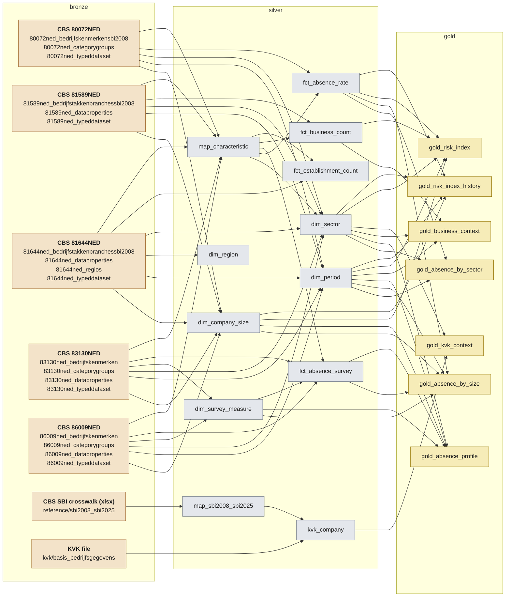

## Contents

Silver: [`map_characteristic`](#map_characteristic), [`dim_sector`](#dim_sector), [`dim_company_size`](#dim_company_size), [`dim_period`](#dim_period), [`dim_region`](#dim_region), [`dim_survey_measure`](#dim_survey_measure), [`map_sbi2008_sbi2025`](#map_sbi2008_sbi2025), [`fct_absence_rate`](#fct_absence_rate), [`fct_absence_survey`](#fct_absence_survey), [`fct_business_count`](#fct_business_count), [`fct_establishment_count`](#fct_establishment_count), [`kvk_company`](#kvk_company)

Gold: [`gold_absence_by_sector`](#gold_absence_by_sector), [`gold_absence_by_size`](#gold_absence_by_size), [`gold_absence_profile`](#gold_absence_profile), [`gold_business_context`](#gold_business_context), [`gold_kvk_context`](#gold_kvk_context), [`gold_risk_index`](#gold_risk_index), [`gold_risk_index_history`](#gold_risk_index_history)

## map_characteristic

A silver table, built by `pipeline/silver/cbs.py`.

```mermaid
flowchart LR
  n_src_80072ned_bedrijfskenmerkensbi2008_81589ned_bedrijfstakkenbranchessbi2008_81644ned_bedrijfstakkenbranchessbi2008_83130ned_bedrijfskenmerken_86009ned_bedrijfskenmerken_CategoryGroupID["5 code lists of sectors and size classes<br/>CategoryGroupID"]:::bronze
  n_src_80072ned_bedrijfskenmerkensbi2008_81589ned_bedrijfstakkenbranchessbi2008_81644ned_bedrijfstakkenbranchessbi2008_83130ned_bedrijfskenmerken_86009ned_bedrijfskenmerken_Key["5 code lists of sectors and size classes<br/>Key"]:::bronze
  n_src_80072ned_bedrijfskenmerkensbi2008_81589ned_bedrijfstakkenbranchessbi2008_81644ned_bedrijfstakkenbranchessbi2008_83130ned_bedrijfskenmerken_86009ned_bedrijfskenmerken_Title["5 code lists of sectors and size classes<br/>Title"]:::bronze
  n_src_80072ned_bedrijfskenmerkensbi2008_81589ned_bedrijfstakkenbranchessbi2008_81644ned_bedrijfstakkenbranchessbi2008_83130ned_bedrijfskenmerken_86009ned_bedrijfskenmerken__entity["5 code lists of sectors and size classes<br/>_entity"]:::bronze
  n_src_80072ned_bedrijfskenmerkensbi2008_81589ned_bedrijfstakkenbranchessbi2008_81644ned_bedrijfstakkenbranchessbi2008_83130ned_bedrijfskenmerken_86009ned_bedrijfskenmerken__table_id["5 code lists of sectors and size classes<br/>_table_id"]:::bronze
  n_src_80072ned_categorygroups_83130ned_categorygroups_86009ned_categorygroups_ID["3 category-group lists<br/>ID"]:::bronze
  n_src_80072ned_categorygroups_83130ned_categorygroups_86009ned_categorygroups_Title["3 category-group lists<br/>Title"]:::bronze
  run(["the silver run (pipeline/common/publish.py)"]):::run
  subgraph n_tbl_map_characteristic["silver: map_characteristic"]
    n_col_source_table["source_table"]:::silver
    n_col_dimension["dimension"]:::silver
    n_col_characteristic_key["characteristic_key"]:::silver
    n_col_title["title"]:::silver
    n_col_category_group["category_group"]:::silver
    n_col_member_type["member_type"]:::silver
    n_col_sector_key["sector_key"]:::silver
    n_col_size_key["size_key"]:::silver
    n_col_size_is_aggregate["size_is_aggregate"]:::silver
    n_col_run_id["run_id"]:::silver
  end
  n_src_80072ned_bedrijfskenmerkensbi2008_81589ned_bedrijfstakkenbranchessbi2008_81644ned_bedrijfstakkenbranchessbi2008_83130ned_bedrijfskenmerken_86009ned_bedrijfskenmerken__table_id --> n_col_source_table
  n_src_80072ned_bedrijfskenmerkensbi2008_81589ned_bedrijfstakkenbranchessbi2008_81644ned_bedrijfstakkenbranchessbi2008_83130ned_bedrijfskenmerken_86009ned_bedrijfskenmerken__entity --> n_col_dimension
  n_src_80072ned_bedrijfskenmerkensbi2008_81589ned_bedrijfstakkenbranchessbi2008_81644ned_bedrijfstakkenbranchessbi2008_83130ned_bedrijfskenmerken_86009ned_bedrijfskenmerken_Key --> n_col_characteristic_key
  n_src_80072ned_bedrijfskenmerkensbi2008_81589ned_bedrijfstakkenbranchessbi2008_81644ned_bedrijfstakkenbranchessbi2008_83130ned_bedrijfskenmerken_86009ned_bedrijfskenmerken_Title --> n_col_title
  n_src_80072ned_bedrijfskenmerkensbi2008_81589ned_bedrijfstakkenbranchessbi2008_81644ned_bedrijfstakkenbranchessbi2008_83130ned_bedrijfskenmerken_86009ned_bedrijfskenmerken_CategoryGroupID --> n_col_category_group
  n_src_80072ned_categorygroups_83130ned_categorygroups_86009ned_categorygroups_ID --> n_col_category_group
  n_src_80072ned_categorygroups_83130ned_categorygroups_86009ned_categorygroups_Title --> n_col_category_group
  n_src_80072ned_bedrijfskenmerkensbi2008_81589ned_bedrijfstakkenbranchessbi2008_81644ned_bedrijfstakkenbranchessbi2008_83130ned_bedrijfskenmerken_86009ned_bedrijfskenmerken_Key --> n_col_member_type
  n_src_80072ned_bedrijfskenmerkensbi2008_81589ned_bedrijfstakkenbranchessbi2008_81644ned_bedrijfstakkenbranchessbi2008_83130ned_bedrijfskenmerken_86009ned_bedrijfskenmerken_Title --> n_col_member_type
  n_src_80072ned_bedrijfskenmerkensbi2008_81589ned_bedrijfstakkenbranchessbi2008_81644ned_bedrijfstakkenbranchessbi2008_83130ned_bedrijfskenmerken_86009ned_bedrijfskenmerken_Key --> n_col_sector_key
  n_src_80072ned_bedrijfskenmerkensbi2008_81589ned_bedrijfstakkenbranchessbi2008_81644ned_bedrijfstakkenbranchessbi2008_83130ned_bedrijfskenmerken_86009ned_bedrijfskenmerken_Title --> n_col_size_key
  n_src_80072ned_bedrijfskenmerkensbi2008_81589ned_bedrijfstakkenbranchessbi2008_81644ned_bedrijfstakkenbranchessbi2008_83130ned_bedrijfskenmerken_86009ned_bedrijfskenmerken_Title --> n_col_size_is_aggregate
  run --> n_col_run_id
  classDef bronze fill:#f3e3c9,stroke:#a8743a,color:#1d1d1d
  classDef silver fill:#e4e7ec,stroke:#6b7480,color:#1d1d1d
  classDef gold fill:#f6ecb8,stroke:#9c7f12,color:#1d1d1d
  classDef silverref fill:#f2f3f5,stroke:#9aa1ab,stroke-dasharray:4 3,color:#1d1d1d
  classDef run fill:#ffffff,stroke:#9aa1ab,color:#52514e
```

| Column | Comes from | How |
|---|---|---|
| `source_table` | `80072ned_bedrijfskenmerkensbi2008._table_id` `86009ned_bedrijfskenmerken._table_id` `83130ned_bedrijfskenmerken._table_id` `81589ned_bedrijfstakkenbranchessbi2008._table_id` `81644ned_bedrijfstakkenbranchessbi2008._table_id` | the CBS table the key belongs to |
| `dimension` | `80072ned_bedrijfskenmerkensbi2008._entity` `86009ned_bedrijfskenmerken._entity` `83130ned_bedrijfskenmerken._entity` `81589ned_bedrijfstakkenbranchessbi2008._entity` `81644ned_bedrijfstakkenbranchessbi2008._entity` | the code list's name, e.g. BedrijfskenmerkenSBI2008 |
| `characteristic_key` | `80072ned_bedrijfskenmerkensbi2008.Key` `86009ned_bedrijfskenmerken.Key` `83130ned_bedrijfskenmerken.Key` `81589ned_bedrijfstakkenbranchessbi2008.Key` `81644ned_bedrijfstakkenbranchessbi2008.Key` | as given (padding removed) |
| `title` | `80072ned_bedrijfskenmerkensbi2008.Title` `86009ned_bedrijfskenmerken.Title` `83130ned_bedrijfskenmerken.Title` `81589ned_bedrijfstakkenbranchessbi2008.Title` `81644ned_bedrijfstakkenbranchessbi2008.Title` | as given (spaces trimmed) |
| `category_group` | `80072ned_bedrijfskenmerkensbi2008.CategoryGroupID` `86009ned_bedrijfskenmerken.CategoryGroupID` `83130ned_bedrijfskenmerken.CategoryGroupID` `81589ned_bedrijfstakkenbranchessbi2008.CategoryGroupID` `81644ned_bedrijfstakkenbranchessbi2008.CategoryGroupID` `80072ned_categorygroups.ID` `80072ned_categorygroups.Title` `86009ned_categorygroups.ID` `86009ned_categorygroups.Title` `83130ned_categorygroups.ID` `83130ned_categorygroups.Title` | the title of the key's category group (e.g. Bedrijfsgrootte) |
| `member_type` | `80072ned_bedrijfskenmerkensbi2008.Key` `80072ned_bedrijfskenmerkensbi2008.Title` `86009ned_bedrijfskenmerken.Key` `86009ned_bedrijfskenmerken.Title` `83130ned_bedrijfskenmerken.Key` `83130ned_bedrijfskenmerken.Title` `81589ned_bedrijfstakkenbranchessbi2008.Key` `81589ned_bedrijfstakkenbranchessbi2008.Title` `81644ned_bedrijfstakkenbranchessbi2008.Key` `81644ned_bedrijfstakkenbranchessbi2008.Title` | 'size' when the title reads like a size class (whole words 'werknemers' / 'werkzame personen'), 'total' for T001081 or a title starting with A-U, otherwise 'sector' |
| `sector_key` | `80072ned_bedrijfskenmerkensbi2008.Key` `86009ned_bedrijfskenmerken.Key` `83130ned_bedrijfskenmerken.Key` `81589ned_bedrijfstakkenbranchessbi2008.Key` `81644ned_bedrijfstakkenbranchessbi2008.Key` | the key itself, for sectors and the total |
| `size_key` | `80072ned_bedrijfskenmerkensbi2008.Title` `86009ned_bedrijfskenmerken.Title` `83130ned_bedrijfskenmerken.Title` `81589ned_bedrijfstakkenbranchessbi2008.Title` `81644ned_bedrijfstakkenbranchessbi2008.Title` | size class parsed from the title, e.g. '1 tot 10 werkzame personen' -> WP_1_10 (size rows only) |
| `size_is_aggregate` | `80072ned_bedrijfskenmerkensbi2008.Title` `86009ned_bedrijfskenmerken.Title` `83130ned_bedrijfskenmerken.Title` `81589ned_bedrijfstakkenbranchessbi2008.Title` `81644ned_bedrijfstakkenbranchessbi2008.Title` | true when the class contains other classes of the same table, e.g. 1-9 contains 1-4 and 5-9 (size rows only) |
| `run_id` | *(the run)* | added when the run publishes the table: the silver run that made the row; joins to lakehouse/_run_log (when, which code, which bronze versions) |

## dim_sector

A silver table, built by `pipeline/silver/cbs.py`.

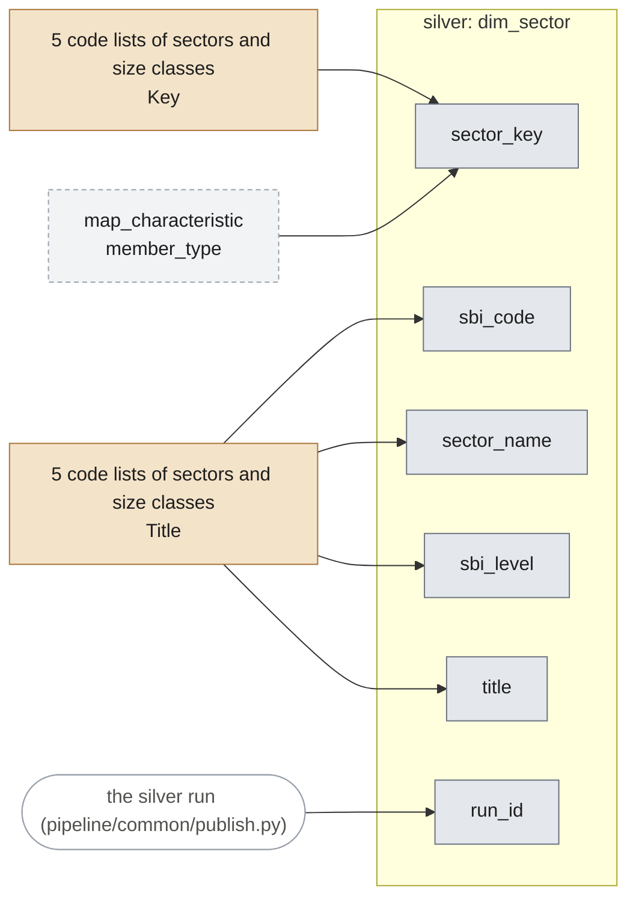

| Column | Comes from | How |
|---|---|---|
| `sector_key` | `80072ned_bedrijfskenmerkensbi2008.Key` `86009ned_bedrijfskenmerken.Key` `83130ned_bedrijfskenmerken.Key` `81589ned_bedrijfstakkenbranchessbi2008.Key` `81644ned_bedrijfstakkenbranchessbi2008.Key` `silver:map_characteristic.member_type` | the keys map_characteristic marks as sector or total; one row per key (CBS uses the same key in every table) |
| `sbi_code` | `80072ned_bedrijfskenmerkensbi2008.Title` `86009ned_bedrijfskenmerken.Title` `83130ned_bedrijfskenmerken.Title` `81589ned_bedrijfstakkenbranchessbi2008.Title` `81644ned_bedrijfstakkenbranchessbi2008.Title` | the code at the start of the title: 'C Industrie' -> C |
| `sector_name` | `80072ned_bedrijfskenmerkensbi2008.Title` `86009ned_bedrijfskenmerken.Title` `83130ned_bedrijfskenmerken.Title` `81589ned_bedrijfstakkenbranchessbi2008.Title` `81644ned_bedrijfstakkenbranchessbi2008.Title` | the rest of the title: 'C Industrie' -> Industrie |
| `sbi_level` | `80072ned_bedrijfskenmerkensbi2008.Title` `86009ned_bedrijfskenmerken.Title` `83130ned_bedrijfskenmerken.Title` `81589ned_bedrijfstakkenbranchessbi2008.Title` `81644ned_bedrijfstakkenbranchessbi2008.Title` | from the code's form: A-U total, C section, B-F section_group, 47 division, 812 group, 10-12 division_group, ... |
| `title` | `80072ned_bedrijfskenmerkensbi2008.Title` `86009ned_bedrijfskenmerken.Title` `83130ned_bedrijfskenmerken.Title` `81589ned_bedrijfstakkenbranchessbi2008.Title` `81644ned_bedrijfstakkenbranchessbi2008.Title` | as given; when tables differ, the most common title |
| `run_id` | *(the run)* | added when the run publishes the table: the silver run that made the row; joins to lakehouse/_run_log (when, which code, which bronze versions) |

## dim_company_size

A silver table, built by `pipeline/silver/cbs.py`.

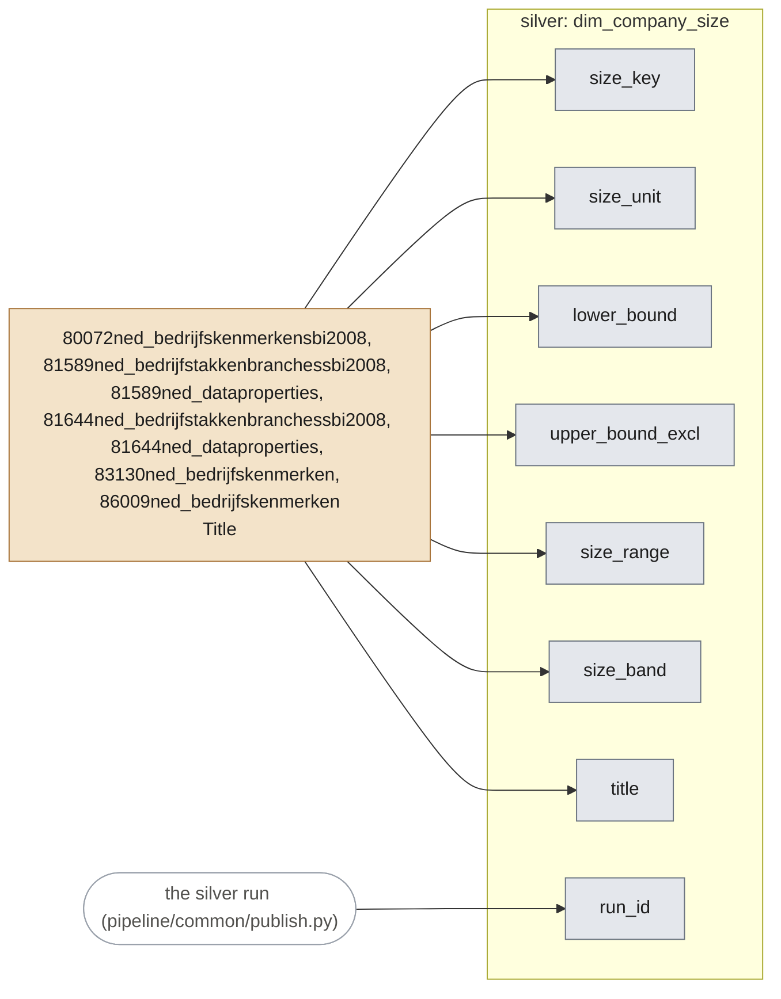

| Column | Comes from | How |
|---|---|---|
| `size_key` | `80072ned_bedrijfskenmerkensbi2008.Title` `86009ned_bedrijfskenmerken.Title` `83130ned_bedrijfskenmerken.Title` `81589ned_bedrijfstakkenbranchessbi2008.Title` `81644ned_bedrijfstakkenbranchessbi2008.Title` `81589ned_dataproperties.Title` `81644ned_dataproperties.Title` | unit and bounds parsed from a size-class title: WN (employees) or WP (persons employed), lower, upper -> e.g. WP_1_10 |
| `size_unit` | `80072ned_bedrijfskenmerkensbi2008.Title` `86009ned_bedrijfskenmerken.Title` `83130ned_bedrijfskenmerken.Title` `81589ned_bedrijfstakkenbranchessbi2008.Title` `81644ned_bedrijfstakkenbranchessbi2008.Title` `81589ned_dataproperties.Title` `81644ned_dataproperties.Title` | 'employees' (werknemers) or 'persons_employed' (werkzame personen) |
| `lower_bound` | `80072ned_bedrijfskenmerkensbi2008.Title` `86009ned_bedrijfskenmerken.Title` `83130ned_bedrijfskenmerken.Title` `81589ned_bedrijfstakkenbranchessbi2008.Title` `81644ned_bedrijfstakkenbranchessbi2008.Title` `81589ned_dataproperties.Title` `81644ned_dataproperties.Title` | the first number of the title ('1 000' -> 1000) |
| `upper_bound_excl` | `80072ned_bedrijfskenmerkensbi2008.Title` `86009ned_bedrijfskenmerken.Title` `83130ned_bedrijfskenmerken.Title` `81589ned_bedrijfstakkenbranchessbi2008.Title` `81644ned_bedrijfstakkenbranchessbi2008.Title` `81589ned_dataproperties.Title` `81644ned_dataproperties.Title` | the upper bound, exclusive; empty for 'of meer' (no upper bound) |
| `size_range` | `80072ned_bedrijfskenmerkensbi2008.Title` `86009ned_bedrijfskenmerken.Title` `83130ned_bedrijfskenmerken.Title` `81589ned_bedrijfstakkenbranchessbi2008.Title` `81644ned_bedrijfstakkenbranchessbi2008.Title` `81589ned_dataproperties.Title` `81644ned_dataproperties.Title` | readable range from the bounds: 1-9, 100+ |
| `size_band` | `80072ned_bedrijfskenmerkensbi2008.Title` `86009ned_bedrijfskenmerken.Title` `83130ned_bedrijfskenmerken.Title` `81589ned_bedrijfstakkenbranchessbi2008.Title` `81644ned_bedrijfstakkenbranchessbi2008.Title` `81589ned_dataproperties.Title` `81644ned_dataproperties.Title` | <10, 10-99 or 100+: the band that contains the class |
| `title` | `80072ned_bedrijfskenmerkensbi2008.Title` `86009ned_bedrijfskenmerken.Title` `83130ned_bedrijfskenmerken.Title` `81589ned_bedrijfstakkenbranchessbi2008.Title` `81644ned_bedrijfstakkenbranchessbi2008.Title` `81589ned_dataproperties.Title` `81644ned_dataproperties.Title` | as given (spaces normalised) |
| `run_id` | *(the run)* | added when the run publishes the table: the silver run that made the row; joins to lakehouse/_run_log (when, which code, which bronze versions) |

## dim_period

A silver table, built by `pipeline/silver/cbs.py`.

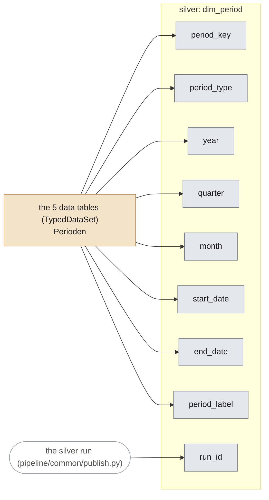

| Column | Comes from | How |
|---|---|---|
| `period_key` | `80072ned_typeddataset.Perioden` `86009ned_typeddataset.Perioden` `83130ned_typeddataset.Perioden` `81589ned_typeddataset.Perioden` `81644ned_typeddataset.Perioden` | every period key that occurs in a fact table |
| `period_type` | `80072ned_typeddataset.Perioden` `86009ned_typeddataset.Perioden` `83130ned_typeddataset.Perioden` `81589ned_typeddataset.Perioden` `81644ned_typeddataset.Perioden` | from the key: KW quarter, JJ year, MM month, HJ half year |
| `year` | `80072ned_typeddataset.Perioden` `86009ned_typeddataset.Perioden` `83130ned_typeddataset.Perioden` `81589ned_typeddataset.Perioden` `81644ned_typeddataset.Perioden` | the first four digits |
| `quarter` | `80072ned_typeddataset.Perioden` `86009ned_typeddataset.Perioden` `83130ned_typeddataset.Perioden` `81589ned_typeddataset.Perioden` `81644ned_typeddataset.Perioden` | the quarter (KW, MM keys) |
| `month` | `80072ned_typeddataset.Perioden` `86009ned_typeddataset.Perioden` `83130ned_typeddataset.Perioden` `81589ned_typeddataset.Perioden` `81644ned_typeddataset.Perioden` | the month (MM keys) |
| `start_date` | `80072ned_typeddataset.Perioden` `86009ned_typeddataset.Perioden` `83130ned_typeddataset.Perioden` `81589ned_typeddataset.Perioden` `81644ned_typeddataset.Perioden` | first day of the period |
| `end_date` | `80072ned_typeddataset.Perioden` `86009ned_typeddataset.Perioden` `83130ned_typeddataset.Perioden` `81589ned_typeddataset.Perioden` `81644ned_typeddataset.Perioden` | last day of the period |
| `period_label` | `80072ned_typeddataset.Perioden` `86009ned_typeddataset.Perioden` `83130ned_typeddataset.Perioden` `81589ned_typeddataset.Perioden` `81644ned_typeddataset.Perioden` | readable label: 2026 Q2, 2025 |
| `run_id` | *(the run)* | added when the run publishes the table: the silver run that made the row; joins to lakehouse/_run_log (when, which code, which bronze versions) |

## dim_region

A silver table, built by `pipeline/silver/cbs.py`.

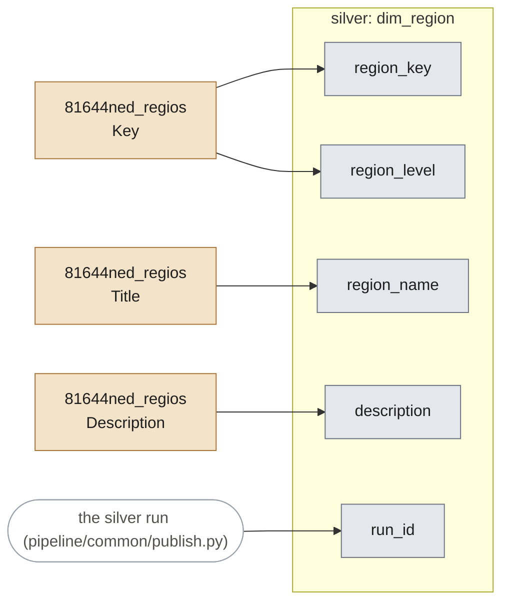

| Column | Comes from | How |
|---|---|---|
| `region_key` | `81644ned_regios.Key` | as given (padding removed) |
| `region_name` | `81644ned_regios.Title` | the title without its level suffix: 'Groningen (PV)' -> Groningen |
| `region_level` | `81644ned_regios.Key` | from the key's prefix: NL country, LD landsdeel, PV province, CR corop, GM municipality |
| `description` | `81644ned_regios.Description` | as given |
| `run_id` | *(the run)* | added when the run publishes the table: the silver run that made the row; joins to lakehouse/_run_log (when, which code, which bronze versions) |

## dim_survey_measure

A silver table, built by `pipeline/silver/cbs.py`.

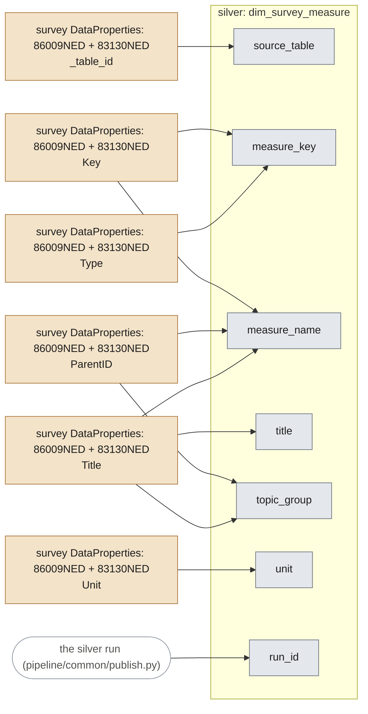

| Column | Comes from | How |
|---|---|---|
| `source_table` | `86009ned_dataproperties._table_id` `83130ned_dataproperties._table_id` | the survey table |
| `measure_key` | `86009ned_dataproperties.Key` `86009ned_dataproperties.Type` `83130ned_dataproperties.Key` `83130ned_dataproperties.Type` | the key of every Topic (measure) in DataProperties |
| `measure_name` | `86009ned_dataproperties.Key` `86009ned_dataproperties.ParentID` `86009ned_dataproperties.Title` `83130ned_dataproperties.Key` `83130ned_dataproperties.ParentID` `83130ned_dataproperties.Title` | the key in snake_case ('AantalKeerVerzuimd_2' -> aantal_keer_verzuimd); a name that occurs twice gets the era of its topic group (_until_2022 / _from_2022) |
| `title` | `86009ned_dataproperties.Title` `83130ned_dataproperties.Title` | as given |
| `topic_group` | `86009ned_dataproperties.ParentID` `86009ned_dataproperties.Title` `83130ned_dataproperties.ParentID` `83130ned_dataproperties.Title` | the titles of the TopicGroups above the measure (via ParentID), joined with ' / ' |
| `unit` | `86009ned_dataproperties.Unit` `83130ned_dataproperties.Unit` | as given: %, gemiddelde, ... |
| `run_id` | *(the run)* | added when the run publishes the table: the silver run that made the row; joins to lakehouse/_run_log (when, which code, which bronze versions) |

## map_sbi2008_sbi2025

A silver table, built by `pipeline/silver/cbs.py`.

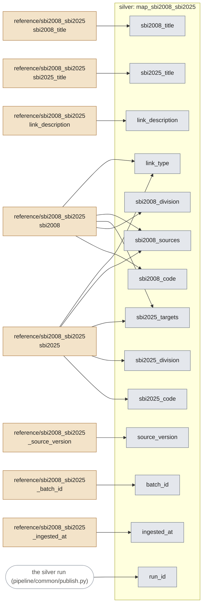

| Column | Comes from | How |
|---|---|---|
| `sbi2008_code` | `reference/sbi2008_sbi2025.sbi2008` | as given, newest file version only |
| `sbi2008_division` | `reference/sbi2008_sbi2025.sbi2008` | the code's first two digits |
| `sbi2008_title` | `reference/sbi2008_sbi2025.sbi2008_title` | as given |
| `sbi2025_code` | `reference/sbi2008_sbi2025.sbi2025` | as given |
| `sbi2025_division` | `reference/sbi2008_sbi2025.sbi2025` | the code's first two digits (not the file's 2-digit column, which is wrong in 5 rows) |
| `sbi2025_title` | `reference/sbi2008_sbi2025.sbi2025_title` | as given |
| `link_description` | `reference/sbi2008_sbi2025.link_description` | as given |
| `sbi2025_targets` | `reference/sbi2008_sbi2025.sbi2008` `reference/sbi2008_sbi2025.sbi2025` | number of SBI 2025 codes this SBI 2008 code links to |
| `sbi2008_sources` | `reference/sbi2008_sbi2025.sbi2008` `reference/sbi2008_sbi2025.sbi2025` | number of SBI 2008 codes linking to this SBI 2025 code |
| `link_type` | `reference/sbi2008_sbi2025.sbi2008` `reference/sbi2008_sbi2025.sbi2025` | 1:1, split (one old code -> several new), merge (several old -> one new) or many-to-many, from the two counts |
| `source_version` | `reference/sbi2008_sbi2025._source_version` | the file version, from its sheet name (v2.0) |
| `batch_id` | `reference/sbi2008_sbi2025._batch_id` | the loaded file version (batch) |
| `ingested_at` | `reference/sbi2008_sbi2025._ingested_at` | when the file was loaded (UTC) |
| `run_id` | *(the run)* | added when the run publishes the table: the silver run that made the row; joins to lakehouse/_run_log (when, which code, which bronze versions) |

## fct_absence_rate

A silver table, built by `pipeline/silver/cbs.py`.

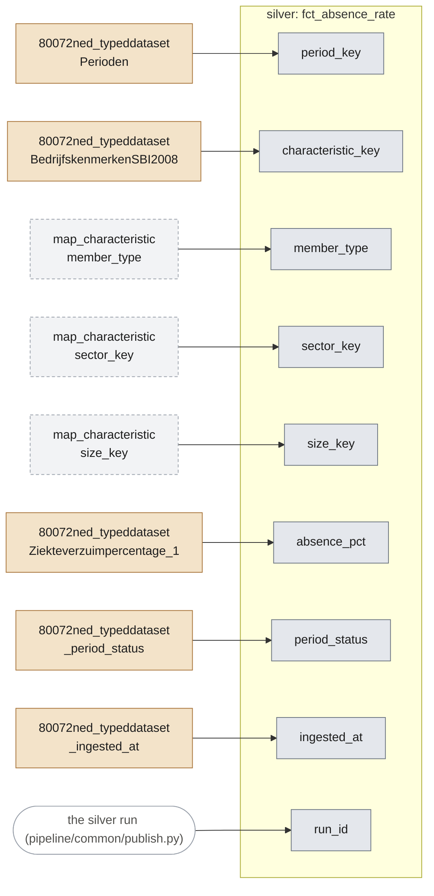

| Column | Comes from | How |
|---|---|---|
| `period_key` | `80072ned_typeddataset.Perioden` | as given |
| `characteristic_key` | `80072ned_typeddataset.BedrijfskenmerkenSBI2008` | as given (padding removed) |
| `member_type` | `silver:map_characteristic.member_type` | looked up by characteristic_key: sector, size, total or unknown |
| `sector_key` | `silver:map_characteristic.sector_key` | looked up by characteristic_key; filled for sectors and the total, joins to dim_sector |
| `size_key` | `silver:map_characteristic.size_key` | looked up by characteristic_key; filled for size classes, joins to dim_company_size |
| `absence_pct` | `80072ned_typeddataset.Ziekteverzuimpercentage_1` | as a number: sick days as % of available working days |
| `period_status` | `80072ned_typeddataset._period_status` | the period's CBS status when it was loaded (Definitief / Voorlopig / NaderVoorlopig) |
| `ingested_at` | `80072ned_typeddataset._ingested_at` | when the bronze row was loaded (UTC) |
| `run_id` | *(the run)* | added when the run publishes the table: the silver run that made the row; joins to lakehouse/_run_log (when, which code, which bronze versions) |

## fct_absence_survey

A silver table, built by `pipeline/silver/cbs.py`.

```mermaid
flowchart LR
  n_src_83130ned_typeddataset_86009ned_typeddataset_Bedrijfskenmerken["survey data: 86009NED + 83130NED<br/>Bedrijfskenmerken"]:::bronze
  n_src_83130ned_typeddataset_86009ned_typeddataset_Marges["survey data: 86009NED + 83130NED<br/>Marges"]:::bronze
  n_src_83130ned_typeddataset_86009ned_typeddataset_Perioden["survey data: 86009NED + 83130NED<br/>Perioden"]:::bronze
  n_src_83130ned_typeddataset_86009ned_typeddataset__ingested_at["survey data: 86009NED + 83130NED<br/>_ingested_at"]:::bronze
  n_src_83130ned_typeddataset_86009ned_typeddataset__measure_["survey data: 86009NED + 83130NED<br/>(each measure)"]:::bronze
  n_src_83130ned_typeddataset_86009ned_typeddataset__period_status["survey data: 86009NED + 83130NED<br/>_period_status"]:::bronze
  n_src_83130ned_typeddataset_86009ned_typeddataset__table_id["survey data: 86009NED + 83130NED<br/>_table_id"]:::bronze
  n_src_silver_dim_survey_measure_measure_name["dim_survey_measure<br/>measure_name"]:::silverref
  n_src_silver_map_characteristic_member_type["map_characteristic<br/>member_type"]:::silverref
  n_src_silver_map_characteristic_sector_key["map_characteristic<br/>sector_key"]:::silverref
  n_src_silver_map_characteristic_size_is_aggregate["map_characteristic<br/>size_is_aggregate"]:::silverref
  n_src_silver_map_characteristic_size_key["map_characteristic<br/>size_key"]:::silverref
  run(["the silver run (pipeline/common/publish.py)"]):::run
  subgraph n_tbl_fct_absence_survey["silver: fct_absence_survey"]
    n_col_source_table["source_table"]:::silver
    n_col_period_key["period_key"]:::silver
    n_col_characteristic_key["characteristic_key"]:::silver
    n_col_member_type["member_type"]:::silver
    n_col_sector_key["sector_key"]:::silver
    n_col_size_key["size_key"]:::silver
    n_col_size_is_aggregate["size_is_aggregate"]:::silver
    n_col_measure_key["measure_key"]:::silver
    n_col_measure_name["measure_name"]:::silver
    n_col_value["value"]:::silver
    n_col_lower_95["lower_95"]:::silver
    n_col_upper_95["upper_95"]:::silver
    n_col_period_status["period_status"]:::silver
    n_col_ingested_at["ingested_at"]:::silver
    n_col_run_id["run_id"]:::silver
  end
  n_src_83130ned_typeddataset_86009ned_typeddataset__table_id --> n_col_source_table
  n_src_83130ned_typeddataset_86009ned_typeddataset_Perioden --> n_col_period_key
  n_src_83130ned_typeddataset_86009ned_typeddataset_Bedrijfskenmerken --> n_col_characteristic_key
  n_src_silver_map_characteristic_member_type --> n_col_member_type
  n_src_silver_map_characteristic_sector_key --> n_col_sector_key
  n_src_silver_map_characteristic_size_key --> n_col_size_key
  n_src_silver_map_characteristic_size_is_aggregate --> n_col_size_is_aggregate
  n_src_83130ned_typeddataset_86009ned_typeddataset__measure_ --> n_col_measure_key
  n_src_silver_dim_survey_measure_measure_name --> n_col_measure_name
  n_src_83130ned_typeddataset_86009ned_typeddataset__measure_ --> n_col_value
  n_src_83130ned_typeddataset_86009ned_typeddataset_Marges --> n_col_value
  n_src_83130ned_typeddataset_86009ned_typeddataset__measure_ --> n_col_lower_95
  n_src_83130ned_typeddataset_86009ned_typeddataset_Marges --> n_col_lower_95
  n_src_83130ned_typeddataset_86009ned_typeddataset__measure_ --> n_col_upper_95
  n_src_83130ned_typeddataset_86009ned_typeddataset_Marges --> n_col_upper_95
  n_src_83130ned_typeddataset_86009ned_typeddataset__period_status --> n_col_period_status
  n_src_83130ned_typeddataset_86009ned_typeddataset__ingested_at --> n_col_ingested_at
  run --> n_col_run_id
  classDef bronze fill:#f3e3c9,stroke:#a8743a,color:#1d1d1d
  classDef silver fill:#e4e7ec,stroke:#6b7480,color:#1d1d1d
  classDef gold fill:#f6ecb8,stroke:#9c7f12,color:#1d1d1d
  classDef silverref fill:#f2f3f5,stroke:#9aa1ab,stroke-dasharray:4 3,color:#1d1d1d
  classDef run fill:#ffffff,stroke:#9aa1ab,color:#52514e
```

| Column | Comes from | How |
|---|---|---|
| `source_table` | `86009ned_typeddataset._table_id` `83130ned_typeddataset._table_id` | 86009NED or 83130NED: kept apart, never mixed |
| `period_key` | `86009ned_typeddataset.Perioden` `83130ned_typeddataset.Perioden` | as given |
| `characteristic_key` | `86009ned_typeddataset.Bedrijfskenmerken` `83130ned_typeddataset.Bedrijfskenmerken` | as given (padding removed) |
| `member_type` | `silver:map_characteristic.member_type` | looked up by characteristic_key: sector, size, total or unknown |
| `sector_key` | `silver:map_characteristic.sector_key` | looked up by characteristic_key; filled for sectors and the total, joins to dim_sector |
| `size_key` | `silver:map_characteristic.size_key` | looked up by characteristic_key; filled for size classes, joins to dim_company_size |
| `size_is_aggregate` | `silver:map_characteristic.size_is_aggregate` | looked up by characteristic_key (size classes only) |
| `measure_key` | `86009ned_typeddataset.<measure>` `83130ned_typeddataset.<measure>` | the name of the measure field; one row per measure (wide -> long) |
| `measure_name` | `silver:dim_survey_measure.measure_name` | looked up by source_table and measure_key |
| `value` | `86009ned_typeddataset.<measure>` `86009ned_typeddataset.Marges` `83130ned_typeddataset.<measure>` `83130ned_typeddataset.Marges` | the measure's value in the record with Marges = MW00000 (the estimate) |
| `lower_95` | `86009ned_typeddataset.<measure>` `86009ned_typeddataset.Marges` `83130ned_typeddataset.<measure>` `83130ned_typeddataset.Marges` | the same measure in the record with Marges = MOG0095 |
| `upper_95` | `86009ned_typeddataset.<measure>` `86009ned_typeddataset.Marges` `83130ned_typeddataset.<measure>` `83130ned_typeddataset.Marges` | the same measure in the record with Marges = MBG0095 |
| `period_status` | `86009ned_typeddataset._period_status` `83130ned_typeddataset._period_status` | the period's CBS status when it was loaded (Definitief / Voorlopig / NaderVoorlopig) |
| `ingested_at` | `86009ned_typeddataset._ingested_at` `83130ned_typeddataset._ingested_at` | when the bronze row was loaded (UTC) |
| `run_id` | *(the run)* | added when the run publishes the table: the silver run that made the row; joins to lakehouse/_run_log (when, which code, which bronze versions) |

## fct_business_count

A silver table, built by `pipeline/silver/cbs.py`.

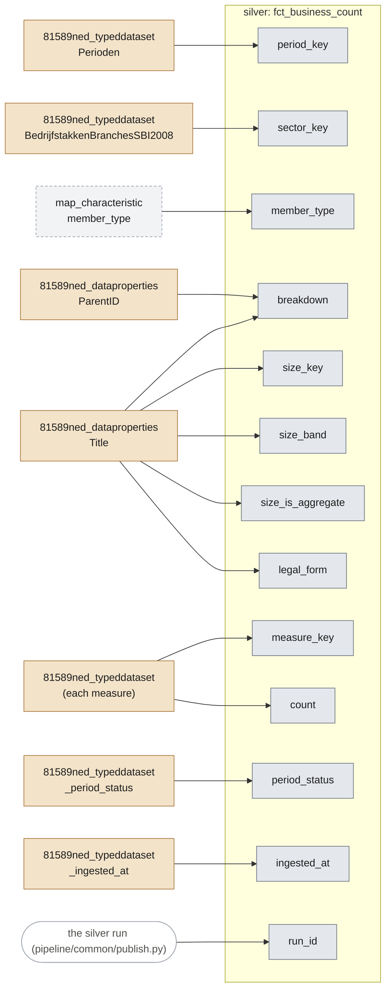

| Column | Comes from | How |
|---|---|---|
| `period_key` | `81589ned_typeddataset.Perioden` | as given (padding removed) |
| `sector_key` | `81589ned_typeddataset.BedrijfstakkenBranchesSBI2008` | as given (padding removed); joins to dim_sector |
| `member_type` | `silver:map_characteristic.member_type` | looked up by sector_key: sector or total |
| `breakdown` | `81589ned_dataproperties.ParentID` `81589ned_dataproperties.Title` | the measure's topic group in DataProperties: 'total' (none), 'size' (…grootte) or 'legal_form' (Rechtsvorm) |
| `measure_key` | `81589ned_typeddataset.<measure>` | the name of the measure field; one row per measure (wide -> long) |
| `size_key` | `81589ned_dataproperties.Title` | size class parsed from the measure's title, e.g. '2 werkzame personen' -> WP_2_3 (size rows only) |
| `size_band` | `81589ned_dataproperties.Title` | <10, 10-99 or 100+ from the parsed bounds (size rows only) |
| `size_is_aggregate` | `81589ned_dataproperties.Title` | true when the class contains other classes of the table (e.g. 0-50); leave out when summing |
| `legal_form` | `81589ned_dataproperties.Title` | the measure's title, for legal-form rows |
| `count` | `81589ned_typeddataset.<measure>` | the measure's value, as a whole number (null when CBS left it empty) |
| `period_status` | `81589ned_typeddataset._period_status` | the period's CBS status when it was loaded (Definitief / Voorlopig / NaderVoorlopig) |
| `ingested_at` | `81589ned_typeddataset._ingested_at` | when the bronze row was loaded (UTC) |
| `run_id` | *(the run)* | added when the run publishes the table: the silver run that made the row; joins to lakehouse/_run_log (when, which code, which bronze versions) |

## fct_establishment_count

A silver table, built by `pipeline/silver/cbs.py`.

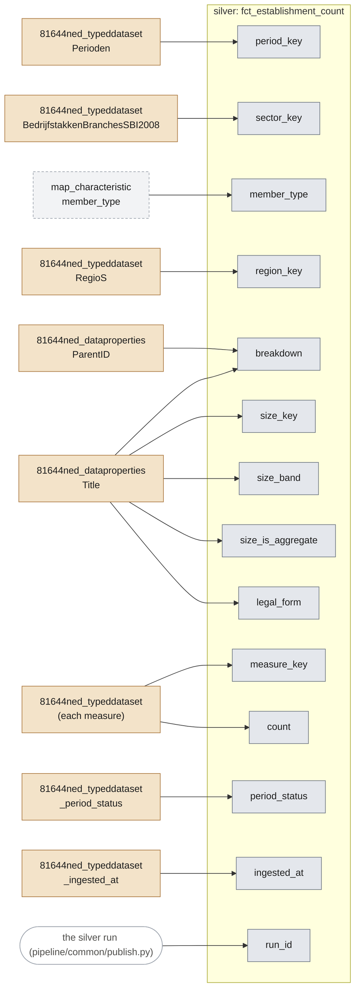

| Column | Comes from | How |
|---|---|---|
| `period_key` | `81644ned_typeddataset.Perioden` | as given (padding removed) |
| `sector_key` | `81644ned_typeddataset.BedrijfstakkenBranchesSBI2008` | as given (padding removed); joins to dim_sector |
| `member_type` | `silver:map_characteristic.member_type` | looked up by sector_key: sector or total |
| `region_key` | `81644ned_typeddataset.RegioS` | as given (padding removed); joins to dim_region |
| `breakdown` | `81644ned_dataproperties.ParentID` `81644ned_dataproperties.Title` | the measure's topic group in DataProperties: 'total' (none), 'size' (…grootte) or 'legal_form' (Rechtsvorm) |
| `measure_key` | `81644ned_typeddataset.<measure>` | the name of the measure field; one row per measure (wide -> long) |
| `size_key` | `81644ned_dataproperties.Title` | size class parsed from the measure's title, e.g. '2 werkzame personen' -> WP_2_3 (size rows only) |
| `size_band` | `81644ned_dataproperties.Title` | <10, 10-99 or 100+ from the parsed bounds (size rows only) |
| `size_is_aggregate` | `81644ned_dataproperties.Title` | true when the class contains other classes of the table (e.g. 0-50); leave out when summing |
| `legal_form` | `81644ned_dataproperties.Title` | the measure's title, for legal-form rows |
| `count` | `81644ned_typeddataset.<measure>` | the measure's value, as a whole number (null when CBS left it empty) |
| `period_status` | `81644ned_typeddataset._period_status` | the period's CBS status when it was loaded (Definitief / Voorlopig / NaderVoorlopig) |
| `ingested_at` | `81644ned_typeddataset._ingested_at` | when the bronze row was loaded (UTC) |
| `run_id` | *(the run)* | added when the run publishes the table: the silver run that made the row; joins to lakehouse/_run_log (when, which code, which bronze versions) |

## kvk_company

A silver table, built by `pipeline/silver/kvk.py`.

```mermaid
flowchart LR
  n_src_kvk_basis_bedrijfsgegevens_Actief["kvk/basis_bedrijfsgegevens<br/>Actief"]:::bronze
  n_src_kvk_basis_bedrijfsgegevens_Datum_aanvang["kvk/basis_bedrijfsgegevens<br/>Datum_aanvang"]:::bronze
  n_src_kvk_basis_bedrijfsgegevens_Hoofdactiviteiten["kvk/basis_bedrijfsgegevens<br/>Hoofdactiviteiten"]:::bronze
  n_src_kvk_basis_bedrijfsgegevens_Insolventie["kvk/basis_bedrijfsgegevens<br/>Insolventie"]:::bronze
  n_src_kvk_basis_bedrijfsgegevens_Lidstaat["kvk/basis_bedrijfsgegevens<br/>Lidstaat"]:::bronze
  n_src_kvk_basis_bedrijfsgegevens_Postcode_regio["kvk/basis_bedrijfsgegevens<br/>Postcode_regio"]:::bronze
  n_src_kvk_basis_bedrijfsgegevens_Rechtsvorm["kvk/basis_bedrijfsgegevens<br/>Rechtsvorm"]:::bronze
  n_src_kvk_basis_bedrijfsgegevens__batch_id["kvk/basis_bedrijfsgegevens<br/>_batch_id"]:::bronze
  n_src_kvk_basis_bedrijfsgegevens__ingested_at["kvk/basis_bedrijfsgegevens<br/>_ingested_at"]:::bronze
  n_src_kvk_basis_bedrijfsgegevens__row_number["kvk/basis_bedrijfsgegevens<br/>_row_number"]:::bronze
  n_src_silver_map_sbi2008_sbi2025_sbi2008_code["map_sbi2008_sbi2025<br/>sbi2008_code"]:::silverref
  n_src_silver_map_sbi2008_sbi2025_sbi2025_code["map_sbi2008_sbi2025<br/>sbi2025_code"]:::silverref
  run(["the silver run (pipeline/common/publish.py)"]):::run
  subgraph n_tbl_kvk_company["silver: kvk_company"]
    n_col_snapshot_date["snapshot_date"]:::silver
    n_col_batch_id["batch_id"]:::silver
    n_col_is_latest["is_latest"]:::silver
    n_col_source_row_number["source_row_number"]:::silver
    n_col_start_date["start_date"]:::silver
    n_col_has_invalid_start_date["has_invalid_start_date"]:::silver
    n_col_is_active["is_active"]:::silver
    n_col_legal_form["legal_form"]:::silver
    n_col_insolvency_code["insolvency_code"]:::silver
    n_col_postcode_region["postcode_region"]:::silver
    n_col_member_state["member_state"]:::silver
    n_col_main_activity_codes["main_activity_codes"]:::silver
    n_col_main_activity_count["main_activity_count"]:::silver
    n_col_has_multiple_main_activities["has_multiple_main_activities"]:::silver
    n_col_has_no_main_activity["has_no_main_activity"]:::silver
    n_col_is_kvk_subcode["is_kvk_subcode"]:::silver
    n_col_sbi_version["sbi_version"]:::silver
    n_col_sbi_mapping["sbi_mapping"]:::silver
    n_col_sbi2008_candidates["sbi2008_candidates"]:::silver
    n_col_sbi2008_code["sbi2008_code"]:::silver
    n_col_sbi2008_division["sbi2008_division"]:::silver
    n_col_sbi2008_section["sbi2008_section"]:::silver
    n_col_run_id["run_id"]:::silver
  end
  n_src_kvk_basis_bedrijfsgegevens__ingested_at --> n_col_snapshot_date
  n_src_kvk_basis_bedrijfsgegevens__batch_id --> n_col_batch_id
  n_src_kvk_basis_bedrijfsgegevens__batch_id --> n_col_is_latest
  n_src_kvk_basis_bedrijfsgegevens__ingested_at --> n_col_is_latest
  n_src_kvk_basis_bedrijfsgegevens__row_number --> n_col_source_row_number
  n_src_kvk_basis_bedrijfsgegevens_Datum_aanvang --> n_col_start_date
  n_src_kvk_basis_bedrijfsgegevens_Datum_aanvang --> n_col_has_invalid_start_date
  n_src_kvk_basis_bedrijfsgegevens_Actief --> n_col_is_active
  n_src_kvk_basis_bedrijfsgegevens_Rechtsvorm --> n_col_legal_form
  n_src_kvk_basis_bedrijfsgegevens_Insolventie --> n_col_insolvency_code
  n_src_kvk_basis_bedrijfsgegevens_Postcode_regio --> n_col_postcode_region
  n_src_kvk_basis_bedrijfsgegevens_Lidstaat --> n_col_member_state
  n_src_kvk_basis_bedrijfsgegevens_Hoofdactiviteiten --> n_col_main_activity_codes
  n_src_kvk_basis_bedrijfsgegevens_Hoofdactiviteiten --> n_col_main_activity_count
  n_src_kvk_basis_bedrijfsgegevens_Hoofdactiviteiten --> n_col_has_multiple_main_activities
  n_src_kvk_basis_bedrijfsgegevens_Hoofdactiviteiten --> n_col_has_no_main_activity
  n_src_kvk_basis_bedrijfsgegevens_Hoofdactiviteiten --> n_col_is_kvk_subcode
  n_src_silver_map_sbi2008_sbi2025_sbi2008_code --> n_col_is_kvk_subcode
  n_src_silver_map_sbi2008_sbi2025_sbi2025_code --> n_col_is_kvk_subcode
  n_src_kvk_basis_bedrijfsgegevens_Hoofdactiviteiten --> n_col_sbi_version
  n_src_silver_map_sbi2008_sbi2025_sbi2008_code --> n_col_sbi_version
  n_src_silver_map_sbi2008_sbi2025_sbi2025_code --> n_col_sbi_version
  n_src_kvk_basis_bedrijfsgegevens_Hoofdactiviteiten --> n_col_sbi_mapping
  n_src_silver_map_sbi2008_sbi2025_sbi2008_code --> n_col_sbi_mapping
  n_src_silver_map_sbi2008_sbi2025_sbi2025_code --> n_col_sbi_mapping
  n_src_kvk_basis_bedrijfsgegevens_Hoofdactiviteiten --> n_col_sbi2008_candidates
  n_src_silver_map_sbi2008_sbi2025_sbi2008_code --> n_col_sbi2008_candidates
  n_src_silver_map_sbi2008_sbi2025_sbi2025_code --> n_col_sbi2008_candidates
  n_src_kvk_basis_bedrijfsgegevens_Hoofdactiviteiten --> n_col_sbi2008_code
  n_src_silver_map_sbi2008_sbi2025_sbi2008_code --> n_col_sbi2008_code
  n_src_silver_map_sbi2008_sbi2025_sbi2025_code --> n_col_sbi2008_code
  n_src_kvk_basis_bedrijfsgegevens_Hoofdactiviteiten --> n_col_sbi2008_division
  n_src_silver_map_sbi2008_sbi2025_sbi2008_code --> n_col_sbi2008_division
  n_src_silver_map_sbi2008_sbi2025_sbi2025_code --> n_col_sbi2008_division
  n_src_kvk_basis_bedrijfsgegevens_Hoofdactiviteiten --> n_col_sbi2008_section
  n_src_silver_map_sbi2008_sbi2025_sbi2008_code --> n_col_sbi2008_section
  n_src_silver_map_sbi2008_sbi2025_sbi2025_code --> n_col_sbi2008_section
  run --> n_col_run_id
  classDef bronze fill:#f3e3c9,stroke:#a8743a,color:#1d1d1d
  classDef silver fill:#e4e7ec,stroke:#6b7480,color:#1d1d1d
  classDef gold fill:#f6ecb8,stroke:#9c7f12,color:#1d1d1d
  classDef silverref fill:#f2f3f5,stroke:#9aa1ab,stroke-dasharray:4 3,color:#1d1d1d
  classDef run fill:#ffffff,stroke:#9aa1ab,color:#52514e
```

| Column | Comes from | How |
|---|---|---|
| `snapshot_date` | `kvk/basis_bedrijfsgegevens._ingested_at` | the day the upload was loaded |
| `batch_id` | `kvk/basis_bedrijfsgegevens._batch_id` | the upload (one batch per file) |
| `is_latest` | `kvk/basis_bedrijfsgegevens._batch_id` `kvk/basis_bedrijfsgegevens._ingested_at` | true for the newest successfully loaded upload |
| `source_row_number` | `kvk/basis_bedrijfsgegevens._row_number` | the row's line in the CSV file |
| `start_date` | `kvk/basis_bedrijfsgegevens.Datum_aanvang` | as a date (YYYYMMDD); empty when it doesn't parse |
| `has_invalid_start_date` | `kvk/basis_bedrijfsgegevens.Datum_aanvang` | true when a non-empty value doesn't parse as a date |
| `is_active` | `kvk/basis_bedrijfsgegevens.Actief` | J -> true, N -> false, anything else empty |
| `legal_form` | `kvk/basis_bedrijfsgegevens.Rechtsvorm` | as given (empty -> null) |
| `insolvency_code` | `kvk/basis_bedrijfsgegevens.Insolventie` | as given (empty -> null) |
| `postcode_region` | `kvk/basis_bedrijfsgegevens.Postcode_regio` | as given (empty -> null) |
| `member_state` | `kvk/basis_bedrijfsgegevens.Lidstaat` | as given (empty -> null) |
| `main_activity_codes` | `kvk/basis_bedrijfsgegevens.Hoofdactiviteiten` | as given: the original comma-separated list |
| `main_activity_count` | `kvk/basis_bedrijfsgegevens.Hoofdactiviteiten` | number of codes in the list |
| `has_multiple_main_activities` | `kvk/basis_bedrijfsgegevens.Hoofdactiviteiten` | more than one code |
| `has_no_main_activity` | `kvk/basis_bedrijfsgegevens.Hoofdactiviteiten` | the list is empty |
| `is_kvk_subcode` | `kvk/basis_bedrijfsgegevens.Hoofdactiviteiten` `silver:map_sbi2008_sbi2025.sbi2008_code` `silver:map_sbi2008_sbi2025.sbi2025_code` | a 6-digit code that is in neither SBI list |
| `sbi_version` | `kvk/basis_bedrijfsgegevens.Hoofdactiviteiten` `silver:map_sbi2008_sbi2025.sbi2008_code` `silver:map_sbi2008_sbi2025.sbi2025_code` | in which SBI list(s) the code(s) occur: 2025, 2008, both, unknown, or mixed |
| `sbi_mapping` | `kvk/basis_bedrijfsgegevens.Hoofdactiviteiten` `silver:map_sbi2008_sbi2025.sbi2008_code` `silver:map_sbi2008_sbi2025.sbi2025_code` | how the code(s) reach SBI 2008: sbi2008, 1:1, merge, ambiguous_version, unknown_code or none (the least certain one) |
| `sbi2008_candidates` | `kvk/basis_bedrijfsgegevens.Hoofdactiviteiten` `silver:map_sbi2008_sbi2025.sbi2008_code` `silver:map_sbi2008_sbi2025.sbi2025_code` | number of SBI 2008 codes the main code(s) could be |
| `sbi2008_code` | `kvk/basis_bedrijfsgegevens.Hoofdactiviteiten` `silver:map_sbi2008_sbi2025.sbi2008_code` `silver:map_sbi2008_sbi2025.sbi2025_code` | filled only when there is exactly one candidate |
| `sbi2008_division` | `kvk/basis_bedrijfsgegevens.Hoofdactiviteiten` `silver:map_sbi2008_sbi2025.sbi2008_code` `silver:map_sbi2008_sbi2025.sbi2025_code` | filled only when all candidates share their first two digits |
| `sbi2008_section` | `kvk/basis_bedrijfsgegevens.Hoofdactiviteiten` `silver:map_sbi2008_sbi2025.sbi2008_code` `silver:map_sbi2008_sbi2025.sbi2025_code` | the SBI 2008 section (letter) of that division |
| `run_id` | *(the run)* | added when the run publishes the table: the silver run that made the row; joins to lakehouse/_run_log (when, which code, which bronze versions) |

## gold_absence_by_sector

A gold table, built by `pipeline/gold/build.py`.

```mermaid
flowchart LR
  n_src_silver_dim_period_period_label["dim_period<br/>period_label"]:::silverref
  n_src_silver_dim_period_quarter["dim_period<br/>quarter"]:::silverref
  n_src_silver_dim_period_year["dim_period<br/>year"]:::silverref
  n_src_silver_dim_sector_sbi_code["dim_sector<br/>sbi_code"]:::silverref
  n_src_silver_dim_sector_sbi_level["dim_sector<br/>sbi_level"]:::silverref
  n_src_silver_dim_sector_sector_name["dim_sector<br/>sector_name"]:::silverref
  n_src_silver_fct_absence_rate_absence_pct["fct_absence_rate<br/>absence_pct"]:::silverref
  n_src_silver_fct_absence_rate_ingested_at["fct_absence_rate<br/>ingested_at"]:::silverref
  n_src_silver_fct_absence_rate_period_key["fct_absence_rate<br/>period_key"]:::silverref
  n_src_silver_fct_absence_rate_period_status["fct_absence_rate<br/>period_status"]:::silverref
  n_src_silver_fct_absence_rate_sector_key["fct_absence_rate<br/>sector_key"]:::silverref
  run(["the gold run (pipeline/common/publish.py)"]):::run
  subgraph n_tbl_gold_absence_by_sector["gold: gold_absence_by_sector"]
    n_col_period_key["period_key"]:::gold
    n_col_period_label["period_label"]:::gold
    n_col_year["year"]:::gold
    n_col_quarter["quarter"]:::gold
    n_col_period_status["period_status"]:::gold
    n_col_is_provisional["is_provisional"]:::gold
    n_col_sector_key["sector_key"]:::gold
    n_col_sbi_code["sbi_code"]:::gold
    n_col_sbi_level["sbi_level"]:::gold
    n_col_sector_name["sector_name"]:::gold
    n_col_absence_pct["absence_pct"]:::gold
    n_col_national_pct["national_pct"]:::gold
    n_col_diff_from_national_pp["diff_from_national_pp"]:::gold
    n_col_rank_in_level["rank_in_level"]:::gold
    n_col_sectors_in_level["sectors_in_level"]:::gold
    n_col_last_year_pct["last_year_pct"]:::gold
    n_col_last_year_status["last_year_status"]:::gold
    n_col_change_vs_last_year_pp["change_vs_last_year_pp"]:::gold
    n_col_yoy_mixes_status["yoy_mixes_status"]:::gold
    n_col_rolling_4q_pct["rolling_4q_pct"]:::gold
    n_col_rolling_4q_has_provisional["rolling_4q_has_provisional"]:::gold
    n_col_data_as_of["data_as_of"]:::gold
    n_col_run_id["run_id"]:::gold
  end
  n_src_silver_fct_absence_rate_period_key --> n_col_period_key
  n_src_silver_dim_period_period_label --> n_col_period_label
  n_src_silver_dim_period_year --> n_col_year
  n_src_silver_dim_period_quarter --> n_col_quarter
  n_src_silver_fct_absence_rate_period_status --> n_col_period_status
  n_src_silver_fct_absence_rate_period_status --> n_col_is_provisional
  n_src_silver_fct_absence_rate_sector_key --> n_col_sector_key
  n_src_silver_dim_sector_sbi_code --> n_col_sbi_code
  n_src_silver_dim_sector_sbi_level --> n_col_sbi_level
  n_src_silver_dim_sector_sector_name --> n_col_sector_name
  n_src_silver_fct_absence_rate_absence_pct --> n_col_absence_pct
  n_src_silver_fct_absence_rate_absence_pct --> n_col_national_pct
  n_src_silver_fct_absence_rate_absence_pct --> n_col_diff_from_national_pp
  n_src_silver_fct_absence_rate_absence_pct --> n_col_rank_in_level
  n_src_silver_fct_absence_rate_absence_pct --> n_col_sectors_in_level
  n_src_silver_fct_absence_rate_absence_pct --> n_col_last_year_pct
  n_src_silver_fct_absence_rate_period_status --> n_col_last_year_status
  n_src_silver_fct_absence_rate_absence_pct --> n_col_change_vs_last_year_pp
  n_src_silver_fct_absence_rate_period_status --> n_col_yoy_mixes_status
  n_src_silver_fct_absence_rate_absence_pct --> n_col_rolling_4q_pct
  n_src_silver_fct_absence_rate_period_status --> n_col_rolling_4q_has_provisional
  n_src_silver_fct_absence_rate_ingested_at --> n_col_data_as_of
  run --> n_col_run_id
  classDef bronze fill:#f3e3c9,stroke:#a8743a,color:#1d1d1d
  classDef silver fill:#e4e7ec,stroke:#6b7480,color:#1d1d1d
  classDef gold fill:#f6ecb8,stroke:#9c7f12,color:#1d1d1d
  classDef silverref fill:#f2f3f5,stroke:#9aa1ab,stroke-dasharray:4 3,color:#1d1d1d
  classDef run fill:#ffffff,stroke:#9aa1ab,color:#52514e
```

| Column | Comes from | How |
|---|---|---|
| `period_key` | `silver:fct_absence_rate.period_key` | as in silver |
| `period_label` | `silver:dim_period.period_label` | looked up in dim_period |
| `year` | `silver:dim_period.year` | looked up in dim_period |
| `quarter` | `silver:dim_period.quarter` | looked up in dim_period |
| `period_status` | `silver:fct_absence_rate.period_status` | as in silver |
| `is_provisional` | `silver:fct_absence_rate.period_status` | true unless the status is Definitief (final) |
| `sector_key` | `silver:fct_absence_rate.sector_key` | as in silver |
| `sbi_code` | `silver:dim_sector.sbi_code` | looked up in dim_sector |
| `sbi_level` | `silver:dim_sector.sbi_level` | looked up in dim_sector |
| `sector_name` | `silver:dim_sector.sector_name` | looked up in dim_sector |
| `absence_pct` | `silver:fct_absence_rate.absence_pct` | as in silver; rows of sectors and the national total (member_type sector or total) |
| `national_pct` | `silver:fct_absence_rate.absence_pct` | the value of the national total (member_type 'total') in the same period |
| `diff_from_national_pp` | `silver:fct_absence_rate.absence_pct` | value minus the national value, in percentage points |
| `rank_in_level` | `silver:fct_absence_rate.absence_pct` | rank within the same period (1 = highest); totals and aggregate classes are not ranked |
| `sectors_in_level` | `silver:fct_absence_rate.absence_pct` | how many were ranked together |
| `last_year_pct` | `silver:fct_absence_rate.absence_pct` | the value in the same period one year earlier |
| `last_year_status` | `silver:fct_absence_rate.period_status` | the status of that period one year earlier |
| `change_vs_last_year_pp` | `silver:fct_absence_rate.absence_pct` | value minus last year's value, in percentage points |
| `yoy_mixes_status` | `silver:fct_absence_rate.period_status` | true when the comparison with last year mixes a provisional and a final figure |
| `rolling_4q_pct` | `silver:fct_absence_rate.absence_pct` | average of four consecutive quarters (empty when one is missing) |
| `rolling_4q_has_provisional` | `silver:fct_absence_rate.period_status` | true when one of those four quarters is provisional |
| `data_as_of` | `silver:fct_absence_rate.ingested_at` | when the bronze row behind it was loaded |
| `run_id` | *(the run)* | added when the run publishes the table: the gold run that made the row; joins to lakehouse/_run_log (which silver run_ids were read) |

## gold_absence_by_size

A gold table, built by `pipeline/gold/build.py`.

```mermaid
flowchart LR
  build(["a fixed value set by pipeline/gold/build.py"]):::run
  n_src_silver_dim_company_size_lower_bound["dim_company_size<br/>lower_bound"]:::silverref
  n_src_silver_dim_company_size_size_band["dim_company_size<br/>size_band"]:::silverref
  n_src_silver_dim_company_size_size_range["dim_company_size<br/>size_range"]:::silverref
  n_src_silver_dim_company_size_size_unit["dim_company_size<br/>size_unit"]:::silverref
  n_src_silver_dim_period_period_label["dim_period<br/>period_label"]:::silverref
  n_src_silver_dim_period_quarter["dim_period<br/>quarter"]:::silverref
  n_src_silver_dim_period_year["dim_period<br/>year"]:::silverref
  n_src_silver_dim_survey_measure_measure_name["dim_survey_measure<br/>measure_name"]:::silverref
  n_src_silver_fct_absence_rate_absence_pct["fct_absence_rate<br/>absence_pct"]:::silverref
  n_src_silver_fct_absence_rate_ingested_at["fct_absence_rate<br/>ingested_at"]:::silverref
  n_src_silver_fct_absence_rate_member_type["fct_absence_rate<br/>member_type"]:::silverref
  n_src_silver_fct_absence_rate_period_key["fct_absence_rate<br/>period_key"]:::silverref
  n_src_silver_fct_absence_rate_period_status["fct_absence_rate<br/>period_status"]:::silverref
  n_src_silver_fct_absence_rate_size_key["fct_absence_rate<br/>size_key"]:::silverref
  n_src_silver_fct_absence_survey_ingested_at["fct_absence_survey<br/>ingested_at"]:::silverref
  n_src_silver_fct_absence_survey_lower_95["fct_absence_survey<br/>lower_95"]:::silverref
  n_src_silver_fct_absence_survey_measure_key["fct_absence_survey<br/>measure_key"]:::silverref
  n_src_silver_fct_absence_survey_member_type["fct_absence_survey<br/>member_type"]:::silverref
  n_src_silver_fct_absence_survey_period_key["fct_absence_survey<br/>period_key"]:::silverref
  n_src_silver_fct_absence_survey_period_status["fct_absence_survey<br/>period_status"]:::silverref
  n_src_silver_fct_absence_survey_size_is_aggregate["fct_absence_survey<br/>size_is_aggregate"]:::silverref
  n_src_silver_fct_absence_survey_size_key["fct_absence_survey<br/>size_key"]:::silverref
  n_src_silver_fct_absence_survey_source_table["fct_absence_survey<br/>source_table"]:::silverref
  n_src_silver_fct_absence_survey_upper_95["fct_absence_survey<br/>upper_95"]:::silverref
  n_src_silver_fct_absence_survey_value["fct_absence_survey<br/>value"]:::silverref
  run(["the gold run (pipeline/common/publish.py)"]):::run
  subgraph n_tbl_gold_absence_by_size["gold: gold_absence_by_size"]
    n_col_source_table["source_table"]:::gold
    n_col_measure["measure"]:::gold
    n_col_period_type["period_type"]:::gold
    n_col_period_key["period_key"]:::gold
    n_col_period_label["period_label"]:::gold
    n_col_year["year"]:::gold
    n_col_quarter["quarter"]:::gold
    n_col_period_status["period_status"]:::gold
    n_col_is_provisional["is_provisional"]:::gold
    n_col_member_type["member_type"]:::gold
    n_col_size_key["size_key"]:::gold
    n_col_size_range["size_range"]:::gold
    n_col_size_unit["size_unit"]:::gold
    n_col_lower_bound["lower_bound"]:::gold
    n_col_size_band["size_band"]:::gold
    n_col_size_is_aggregate["size_is_aggregate"]:::gold
    n_col_value["value"]:::gold
    n_col_lower_95["lower_95"]:::gold
    n_col_upper_95["upper_95"]:::gold
    n_col_national_value["national_value"]:::gold
    n_col_diff_from_national_pp["diff_from_national_pp"]:::gold
    n_col_rank_in_source["rank_in_source"]:::gold
    n_col_classes_ranked["classes_ranked"]:::gold
    n_col_last_year_value["last_year_value"]:::gold
    n_col_last_year_status["last_year_status"]:::gold
    n_col_change_vs_last_year_pp["change_vs_last_year_pp"]:::gold
    n_col_yoy_mixes_status["yoy_mixes_status"]:::gold
    n_col_rolling_4q_value["rolling_4q_value"]:::gold
    n_col_rolling_4q_has_provisional["rolling_4q_has_provisional"]:::gold
    n_col_data_as_of["data_as_of"]:::gold
    n_col_run_id["run_id"]:::gold
  end
  n_src_silver_fct_absence_survey_source_table --> n_col_source_table
  build --> n_col_measure
  n_src_silver_fct_absence_survey_source_table --> n_col_period_type
  n_src_silver_fct_absence_rate_period_key --> n_col_period_key
  n_src_silver_fct_absence_survey_period_key --> n_col_period_key
  n_src_silver_dim_period_period_label --> n_col_period_label
  n_src_silver_dim_period_year --> n_col_year
  n_src_silver_dim_period_quarter --> n_col_quarter
  n_src_silver_fct_absence_rate_period_status --> n_col_period_status
  n_src_silver_fct_absence_survey_period_status --> n_col_period_status
  n_src_silver_fct_absence_rate_period_status --> n_col_is_provisional
  n_src_silver_fct_absence_survey_period_status --> n_col_is_provisional
  n_src_silver_fct_absence_rate_member_type --> n_col_member_type
  n_src_silver_fct_absence_survey_member_type --> n_col_member_type
  n_src_silver_fct_absence_rate_size_key --> n_col_size_key
  n_src_silver_fct_absence_survey_size_key --> n_col_size_key
  n_src_silver_dim_company_size_size_range --> n_col_size_range
  n_src_silver_dim_company_size_size_unit --> n_col_size_unit
  n_src_silver_dim_company_size_lower_bound --> n_col_lower_bound
  n_src_silver_dim_company_size_size_band --> n_col_size_band
  n_src_silver_fct_absence_survey_size_is_aggregate --> n_col_size_is_aggregate
  n_src_silver_fct_absence_rate_absence_pct --> n_col_value
  n_src_silver_fct_absence_survey_value --> n_col_value
  n_src_silver_fct_absence_survey_measure_key --> n_col_value
  n_src_silver_dim_survey_measure_measure_name --> n_col_value
  n_src_silver_fct_absence_survey_lower_95 --> n_col_lower_95
  n_src_silver_fct_absence_survey_upper_95 --> n_col_upper_95
  n_src_silver_fct_absence_rate_absence_pct --> n_col_national_value
  n_src_silver_fct_absence_survey_value --> n_col_national_value
  n_src_silver_fct_absence_rate_absence_pct --> n_col_diff_from_national_pp
  n_src_silver_fct_absence_survey_value --> n_col_diff_from_national_pp
  n_src_silver_fct_absence_rate_absence_pct --> n_col_rank_in_source
  n_src_silver_fct_absence_survey_value --> n_col_rank_in_source
  n_src_silver_fct_absence_rate_absence_pct --> n_col_classes_ranked
  n_src_silver_fct_absence_survey_value --> n_col_classes_ranked
  n_src_silver_fct_absence_rate_absence_pct --> n_col_last_year_value
  n_src_silver_fct_absence_survey_value --> n_col_last_year_value
  n_src_silver_fct_absence_rate_period_status --> n_col_last_year_status
  n_src_silver_fct_absence_survey_period_status --> n_col_last_year_status
  n_src_silver_fct_absence_rate_absence_pct --> n_col_change_vs_last_year_pp
  n_src_silver_fct_absence_survey_value --> n_col_change_vs_last_year_pp
  n_src_silver_fct_absence_rate_period_status --> n_col_yoy_mixes_status
  n_src_silver_fct_absence_survey_period_status --> n_col_yoy_mixes_status
  n_src_silver_fct_absence_rate_absence_pct --> n_col_rolling_4q_value
  n_src_silver_fct_absence_survey_value --> n_col_rolling_4q_value
  n_src_silver_fct_absence_rate_period_status --> n_col_rolling_4q_has_provisional
  n_src_silver_fct_absence_survey_period_status --> n_col_rolling_4q_has_provisional
  n_src_silver_fct_absence_rate_ingested_at --> n_col_data_as_of
  n_src_silver_fct_absence_survey_ingested_at --> n_col_data_as_of
  run --> n_col_run_id
  classDef bronze fill:#f3e3c9,stroke:#a8743a,color:#1d1d1d
  classDef silver fill:#e4e7ec,stroke:#6b7480,color:#1d1d1d
  classDef gold fill:#f6ecb8,stroke:#9c7f12,color:#1d1d1d
  classDef silverref fill:#f2f3f5,stroke:#9aa1ab,stroke-dasharray:4 3,color:#1d1d1d
  classDef run fill:#ffffff,stroke:#9aa1ab,color:#52514e
```

| Column | Comes from | How |
|---|---|---|
| `source_table` | `silver:fct_absence_survey.source_table` | '80072NED' for the quarterly rows from fct_absence_rate; 86009NED for the survey rows |
| `measure` | *(set by gold)* | fixed by gold: absence_pct (80072NED) or share_employees_absent (86009NED) |
| `period_type` | `silver:fct_absence_survey.source_table` | quarter for 80072NED, year for 86009NED |
| `period_key` | `silver:fct_absence_rate.period_key` `silver:fct_absence_survey.period_key` | as in silver |
| `period_label` | `silver:dim_period.period_label` | looked up in dim_period |
| `year` | `silver:dim_period.year` | looked up in dim_period |
| `quarter` | `silver:dim_period.quarter` | looked up in dim_period (empty for years) |
| `period_status` | `silver:fct_absence_rate.period_status` `silver:fct_absence_survey.period_status` | as in silver |
| `is_provisional` | `silver:fct_absence_rate.period_status` `silver:fct_absence_survey.period_status` | true unless the status is Definitief (final) |
| `member_type` | `silver:fct_absence_rate.member_type` `silver:fct_absence_survey.member_type` | as in silver: size or total |
| `size_key` | `silver:fct_absence_rate.size_key` `silver:fct_absence_survey.size_key` | as in silver |
| `size_range` | `silver:dim_company_size.size_range` | looked up in dim_company_size |
| `size_unit` | `silver:dim_company_size.size_unit` | looked up in dim_company_size |
| `lower_bound` | `silver:dim_company_size.lower_bound` | looked up in dim_company_size |
| `size_band` | `silver:dim_company_size.size_band` | looked up in dim_company_size |
| `size_is_aggregate` | `silver:fct_absence_survey.size_is_aggregate` | as in silver for the survey; false for 80072NED |
| `value` | `silver:fct_absence_rate.absence_pct` `silver:fct_absence_survey.value` `silver:fct_absence_survey.measure_key` `silver:dim_survey_measure.measure_name` | absence % (80072NED); for 86009NED the share of employees absent, the survey measure picked by its name in dim_survey_measure |
| `lower_95` | `silver:fct_absence_survey.lower_95` | as in silver (survey only) |
| `upper_95` | `silver:fct_absence_survey.upper_95` | as in silver (survey only) |
| `national_value` | `silver:fct_absence_rate.absence_pct` `silver:fct_absence_survey.value` | the value of the national total (member_type 'total') in the same period |
| `diff_from_national_pp` | `silver:fct_absence_rate.absence_pct` `silver:fct_absence_survey.value` | value minus the national value, in percentage points |
| `rank_in_source` | `silver:fct_absence_rate.absence_pct` `silver:fct_absence_survey.value` | rank within the same period (1 = highest); totals and aggregate classes are not ranked |
| `classes_ranked` | `silver:fct_absence_rate.absence_pct` `silver:fct_absence_survey.value` | how many were ranked together |
| `last_year_value` | `silver:fct_absence_rate.absence_pct` `silver:fct_absence_survey.value` | the value in the same period one year earlier |
| `last_year_status` | `silver:fct_absence_rate.period_status` `silver:fct_absence_survey.period_status` | the status of that period one year earlier |
| `change_vs_last_year_pp` | `silver:fct_absence_rate.absence_pct` `silver:fct_absence_survey.value` | value minus last year's value, in percentage points |
| `yoy_mixes_status` | `silver:fct_absence_rate.period_status` `silver:fct_absence_survey.period_status` | true when the comparison with last year mixes a provisional and a final figure |
| `rolling_4q_value` | `silver:fct_absence_rate.absence_pct` `silver:fct_absence_survey.value` | average of four consecutive quarters (empty when one is missing) |
| `rolling_4q_has_provisional` | `silver:fct_absence_rate.period_status` `silver:fct_absence_survey.period_status` | true when one of those four quarters is provisional |
| `data_as_of` | `silver:fct_absence_rate.ingested_at` `silver:fct_absence_survey.ingested_at` | when the bronze row behind it was loaded |
| `run_id` | *(the run)* | added when the run publishes the table: the gold run that made the row; joins to lakehouse/_run_log (which silver run_ids were read) |

## gold_absence_profile

A gold table, built by `pipeline/gold/build.py`.

```mermaid
flowchart LR
  n_src_silver_dim_company_size_lower_bound["dim_company_size<br/>lower_bound"]:::silverref
  n_src_silver_dim_company_size_size_range["dim_company_size<br/>size_range"]:::silverref
  n_src_silver_dim_company_size_size_unit["dim_company_size<br/>size_unit"]:::silverref
  n_src_silver_dim_period_year["dim_period<br/>year"]:::silverref
  n_src_silver_dim_sector_sbi_code["dim_sector<br/>sbi_code"]:::silverref
  n_src_silver_dim_sector_sbi_level["dim_sector<br/>sbi_level"]:::silverref
  n_src_silver_dim_sector_sector_name["dim_sector<br/>sector_name"]:::silverref
  n_src_silver_dim_survey_measure_title["dim_survey_measure<br/>title"]:::silverref
  n_src_silver_dim_survey_measure_topic_group["dim_survey_measure<br/>topic_group"]:::silverref
  n_src_silver_dim_survey_measure_unit["dim_survey_measure<br/>unit"]:::silverref
  n_src_silver_fct_absence_survey_characteristic_key["fct_absence_survey<br/>characteristic_key"]:::silverref
  n_src_silver_fct_absence_survey_ingested_at["fct_absence_survey<br/>ingested_at"]:::silverref
  n_src_silver_fct_absence_survey_lower_95["fct_absence_survey<br/>lower_95"]:::silverref
  n_src_silver_fct_absence_survey_measure_key["fct_absence_survey<br/>measure_key"]:::silverref
  n_src_silver_fct_absence_survey_measure_name["fct_absence_survey<br/>measure_name"]:::silverref
  n_src_silver_fct_absence_survey_member_type["fct_absence_survey<br/>member_type"]:::silverref
  n_src_silver_fct_absence_survey_period_key["fct_absence_survey<br/>period_key"]:::silverref
  n_src_silver_fct_absence_survey_period_status["fct_absence_survey<br/>period_status"]:::silverref
  n_src_silver_fct_absence_survey_sector_key["fct_absence_survey<br/>sector_key"]:::silverref
  n_src_silver_fct_absence_survey_size_is_aggregate["fct_absence_survey<br/>size_is_aggregate"]:::silverref
  n_src_silver_fct_absence_survey_size_key["fct_absence_survey<br/>size_key"]:::silverref
  n_src_silver_fct_absence_survey_upper_95["fct_absence_survey<br/>upper_95"]:::silverref
  n_src_silver_fct_absence_survey_value["fct_absence_survey<br/>value"]:::silverref
  run(["the gold run (pipeline/common/publish.py)"]):::run
  subgraph n_tbl_gold_absence_profile["gold: gold_absence_profile"]
    n_col_period_key["period_key"]:::gold
    n_col_year["year"]:::gold
    n_col_period_status["period_status"]:::gold
    n_col_is_provisional["is_provisional"]:::gold
    n_col_member_type["member_type"]:::gold
    n_col_characteristic_key["characteristic_key"]:::gold
    n_col_sector_key["sector_key"]:::gold
    n_col_sbi_code["sbi_code"]:::gold
    n_col_sbi_level["sbi_level"]:::gold
    n_col_sector_name["sector_name"]:::gold
    n_col_size_key["size_key"]:::gold
    n_col_size_range["size_range"]:::gold
    n_col_size_unit["size_unit"]:::gold
    n_col_lower_bound["lower_bound"]:::gold
    n_col_size_is_aggregate["size_is_aggregate"]:::gold
    n_col_measure_key["measure_key"]:::gold
    n_col_measure_name["measure_name"]:::gold
    n_col_measure_title["measure_title"]:::gold
    n_col_topic_group["topic_group"]:::gold
    n_col_unit["unit"]:::gold
    n_col_value["value"]:::gold
    n_col_lower_95["lower_95"]:::gold
    n_col_upper_95["upper_95"]:::gold
    n_col_national_value["national_value"]:::gold
    n_col_diff_from_national["diff_from_national"]:::gold
    n_col_differs_from_national["differs_from_national"]:::gold
    n_col_direction["direction"]:::gold
    n_col_rank_in_topic["rank_in_topic"]:::gold
    n_col_data_as_of["data_as_of"]:::gold
    n_col_run_id["run_id"]:::gold
  end
  n_src_silver_fct_absence_survey_period_key --> n_col_period_key
  n_src_silver_dim_period_year --> n_col_year
  n_src_silver_fct_absence_survey_period_status --> n_col_period_status
  n_src_silver_fct_absence_survey_period_status --> n_col_is_provisional
  n_src_silver_fct_absence_survey_member_type --> n_col_member_type
  n_src_silver_fct_absence_survey_characteristic_key --> n_col_characteristic_key
  n_src_silver_fct_absence_survey_sector_key --> n_col_sector_key
  n_src_silver_dim_sector_sbi_code --> n_col_sbi_code
  n_src_silver_dim_sector_sbi_level --> n_col_sbi_level
  n_src_silver_dim_sector_sector_name --> n_col_sector_name
  n_src_silver_fct_absence_survey_size_key --> n_col_size_key
  n_src_silver_dim_company_size_size_range --> n_col_size_range
  n_src_silver_dim_company_size_size_unit --> n_col_size_unit
  n_src_silver_dim_company_size_lower_bound --> n_col_lower_bound
  n_src_silver_fct_absence_survey_size_is_aggregate --> n_col_size_is_aggregate
  n_src_silver_fct_absence_survey_measure_key --> n_col_measure_key
  n_src_silver_fct_absence_survey_measure_name --> n_col_measure_name
  n_src_silver_dim_survey_measure_title --> n_col_measure_title
  n_src_silver_dim_survey_measure_topic_group --> n_col_topic_group
  n_src_silver_dim_survey_measure_unit --> n_col_unit
  n_src_silver_fct_absence_survey_value --> n_col_value
  n_src_silver_fct_absence_survey_lower_95 --> n_col_lower_95
  n_src_silver_fct_absence_survey_upper_95 --> n_col_upper_95
  n_src_silver_fct_absence_survey_value --> n_col_national_value
  n_src_silver_fct_absence_survey_value --> n_col_diff_from_national
  n_src_silver_fct_absence_survey_lower_95 --> n_col_differs_from_national
  n_src_silver_fct_absence_survey_upper_95 --> n_col_differs_from_national
  n_src_silver_fct_absence_survey_value --> n_col_differs_from_national
  n_src_silver_fct_absence_survey_lower_95 --> n_col_direction
  n_src_silver_fct_absence_survey_upper_95 --> n_col_direction
  n_src_silver_fct_absence_survey_value --> n_col_direction
  n_src_silver_fct_absence_survey_value --> n_col_rank_in_topic
  n_src_silver_dim_survey_measure_topic_group --> n_col_rank_in_topic
  n_src_silver_fct_absence_survey_ingested_at --> n_col_data_as_of
  run --> n_col_run_id
  classDef bronze fill:#f3e3c9,stroke:#a8743a,color:#1d1d1d
  classDef silver fill:#e4e7ec,stroke:#6b7480,color:#1d1d1d
  classDef gold fill:#f6ecb8,stroke:#9c7f12,color:#1d1d1d
  classDef silverref fill:#f2f3f5,stroke:#9aa1ab,stroke-dasharray:4 3,color:#1d1d1d
  classDef run fill:#ffffff,stroke:#9aa1ab,color:#52514e
```

| Column | Comes from | How |
|---|---|---|
| `period_key` | `silver:fct_absence_survey.period_key` | as in silver |
| `year` | `silver:dim_period.year` | looked up in dim_period |
| `period_status` | `silver:fct_absence_survey.period_status` | as in silver |
| `is_provisional` | `silver:fct_absence_survey.period_status` | true unless the status is Definitief (final) |
| `member_type` | `silver:fct_absence_survey.member_type` | as in silver |
| `characteristic_key` | `silver:fct_absence_survey.characteristic_key` | as in silver |
| `sector_key` | `silver:fct_absence_survey.sector_key` | as in silver |
| `sbi_code` | `silver:dim_sector.sbi_code` | looked up in dim_sector |
| `sbi_level` | `silver:dim_sector.sbi_level` | looked up in dim_sector |
| `sector_name` | `silver:dim_sector.sector_name` | looked up in dim_sector |
| `size_key` | `silver:fct_absence_survey.size_key` | as in silver |
| `size_range` | `silver:dim_company_size.size_range` | looked up in dim_company_size |
| `size_unit` | `silver:dim_company_size.size_unit` | looked up in dim_company_size |
| `lower_bound` | `silver:dim_company_size.lower_bound` | looked up in dim_company_size |
| `size_is_aggregate` | `silver:fct_absence_survey.size_is_aggregate` | as in silver |
| `measure_key` | `silver:fct_absence_survey.measure_key` | as in silver (86009NED only) |
| `measure_name` | `silver:fct_absence_survey.measure_name` | as in silver |
| `measure_title` | `silver:dim_survey_measure.title` | looked up in dim_survey_measure |
| `topic_group` | `silver:dim_survey_measure.topic_group` | looked up in dim_survey_measure |
| `unit` | `silver:dim_survey_measure.unit` | looked up in dim_survey_measure |
| `value` | `silver:fct_absence_survey.value` | as in silver |
| `lower_95` | `silver:fct_absence_survey.lower_95` | as in silver |
| `upper_95` | `silver:fct_absence_survey.upper_95` | as in silver |
| `national_value` | `silver:fct_absence_survey.value` | the national total's value for the same measure and period |
| `diff_from_national` | `silver:fct_absence_survey.value` | value minus the national value |
| `differs_from_national` | `silver:fct_absence_survey.lower_95` `silver:fct_absence_survey.upper_95` `silver:fct_absence_survey.value` | true when the whole 95% interval lies above or below the national value |
| `direction` | `silver:fct_absence_survey.lower_95` `silver:fct_absence_survey.upper_95` `silver:fct_absence_survey.value` | above or below, when it differs from the national value |
| `rank_in_topic` | `silver:fct_absence_survey.value` `silver:dim_survey_measure.topic_group` | rank of the value among the measures of the same topic group (1 = highest) |
| `data_as_of` | `silver:fct_absence_survey.ingested_at` | when the bronze row behind it was loaded |
| `run_id` | *(the run)* | added when the run publishes the table: the gold run that made the row; joins to lakehouse/_run_log (which silver run_ids were read) |

## gold_business_context

A gold table, built by `pipeline/gold/build.py`.

```mermaid
flowchart LR
  n_src_silver_dim_period_period_label["dim_period<br/>period_label"]:::silverref
  n_src_silver_dim_period_quarter["dim_period<br/>quarter"]:::silverref
  n_src_silver_dim_period_year["dim_period<br/>year"]:::silverref
  n_src_silver_dim_sector_sbi_code["dim_sector<br/>sbi_code"]:::silverref
  n_src_silver_dim_sector_sbi_level["dim_sector<br/>sbi_level"]:::silverref
  n_src_silver_dim_sector_sector_name["dim_sector<br/>sector_name"]:::silverref
  n_src_silver_fct_business_count_breakdown["fct_business_count<br/>breakdown"]:::silverref
  n_src_silver_fct_business_count_count["fct_business_count<br/>count"]:::silverref
  n_src_silver_fct_business_count_ingested_at["fct_business_count<br/>ingested_at"]:::silverref
  n_src_silver_fct_business_count_period_key["fct_business_count<br/>period_key"]:::silverref
  n_src_silver_fct_business_count_period_status["fct_business_count<br/>period_status"]:::silverref
  n_src_silver_fct_business_count_sector_key["fct_business_count<br/>sector_key"]:::silverref
  n_src_silver_fct_business_count_size_band["fct_business_count<br/>size_band"]:::silverref
  n_src_silver_fct_business_count_size_is_aggregate["fct_business_count<br/>size_is_aggregate"]:::silverref
  run(["the gold run (pipeline/common/publish.py)"]):::run
  subgraph n_tbl_gold_business_context["gold: gold_business_context"]
    n_col_period_key["period_key"]:::gold
    n_col_period_label["period_label"]:::gold
    n_col_year["year"]:::gold
    n_col_quarter["quarter"]:::gold
    n_col_period_status["period_status"]:::gold
    n_col_is_provisional["is_provisional"]:::gold
    n_col_sector_key["sector_key"]:::gold
    n_col_sbi_code["sbi_code"]:::gold
    n_col_sbi_level["sbi_level"]:::gold
    n_col_sector_name["sector_name"]:::gold
    n_col_size_band["size_band"]:::gold
    n_col_businesses["businesses"]:::gold
    n_col_data_as_of["data_as_of"]:::gold
    n_col_run_id["run_id"]:::gold
  end
  n_src_silver_fct_business_count_period_key --> n_col_period_key
  n_src_silver_dim_period_period_label --> n_col_period_label
  n_src_silver_dim_period_year --> n_col_year
  n_src_silver_dim_period_quarter --> n_col_quarter
  n_src_silver_fct_business_count_period_status --> n_col_period_status
  n_src_silver_fct_business_count_period_status --> n_col_is_provisional
  n_src_silver_fct_business_count_sector_key --> n_col_sector_key
  n_src_silver_dim_sector_sbi_code --> n_col_sbi_code
  n_src_silver_dim_sector_sbi_level --> n_col_sbi_level
  n_src_silver_dim_sector_sector_name --> n_col_sector_name
  n_src_silver_fct_business_count_size_band --> n_col_size_band
  n_src_silver_fct_business_count_breakdown --> n_col_size_band
  n_src_silver_fct_business_count_count --> n_col_businesses
  n_src_silver_fct_business_count_size_is_aggregate --> n_col_businesses
  n_src_silver_fct_business_count_ingested_at --> n_col_data_as_of
  run --> n_col_run_id
  classDef bronze fill:#f3e3c9,stroke:#a8743a,color:#1d1d1d
  classDef silver fill:#e4e7ec,stroke:#6b7480,color:#1d1d1d
  classDef gold fill:#f6ecb8,stroke:#9c7f12,color:#1d1d1d
  classDef silverref fill:#f2f3f5,stroke:#9aa1ab,stroke-dasharray:4 3,color:#1d1d1d
  classDef run fill:#ffffff,stroke:#9aa1ab,color:#52514e
```

| Column | Comes from | How |
|---|---|---|
| `period_key` | `silver:fct_business_count.period_key` | as in silver |
| `period_label` | `silver:dim_period.period_label` | looked up in dim_period |
| `year` | `silver:dim_period.year` | looked up in dim_period |
| `quarter` | `silver:dim_period.quarter` | looked up in dim_period |
| `period_status` | `silver:fct_business_count.period_status` | as in silver |
| `is_provisional` | `silver:fct_business_count.period_status` | true unless the status is Definitief (final) |
| `sector_key` | `silver:fct_business_count.sector_key` | as in silver |
| `sbi_code` | `silver:dim_sector.sbi_code` | looked up in dim_sector |
| `sbi_level` | `silver:dim_sector.sbi_level` | looked up in dim_sector |
| `sector_name` | `silver:dim_sector.sector_name` | looked up in dim_sector |
| `size_band` | `silver:fct_business_count.size_band` `silver:fct_business_count.breakdown` | the size band; 'all' for CBS's total (breakdown total) |
| `businesses` | `silver:fct_business_count.count` `silver:fct_business_count.size_is_aggregate` | sum of the counts of the band's size classes (aggregate classes left out); empty when one class is missing |
| `data_as_of` | `silver:fct_business_count.ingested_at` | the newest ingest time in the group |
| `run_id` | *(the run)* | added when the run publishes the table: the gold run that made the row; joins to lakehouse/_run_log (which silver run_ids were read) |

## gold_kvk_context

A gold table, built by `pipeline/gold/build.py`.

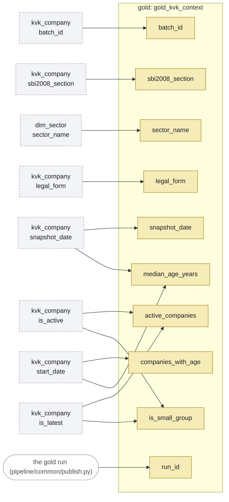

| Column | Comes from | How |
|---|---|---|
| `snapshot_date` | `silver:kvk_company.snapshot_date` | of the latest snapshot (is_latest) |
| `batch_id` | `silver:kvk_company.batch_id` | of the latest snapshot |
| `sbi2008_section` | `silver:kvk_company.sbi2008_section` | as in silver; 'unknown' when not determined |
| `sector_name` | `silver:dim_sector.sector_name` | the section's name, looked up in dim_sector |
| `legal_form` | `silver:kvk_company.legal_form` | as in silver; 'all' for every legal form together |
| `active_companies` | `silver:kvk_company.is_active` `silver:kvk_company.is_latest` | number of active companies in the latest snapshot |
| `companies_with_age` | `silver:kvk_company.start_date` | how many of them have a valid start date |
| `median_age_years` | `silver:kvk_company.start_date` `silver:kvk_company.snapshot_date` | median of (snapshot date - start date), in years |
| `is_small_group` | `silver:kvk_company.is_active` `silver:kvk_company.is_latest` | true under 10 companies (KVK re-identification rule) |
| `run_id` | *(the run)* | added when the run publishes the table: the gold run that made the row; joins to lakehouse/_run_log (which silver run_ids were read) |

## gold_risk_index

A gold table, built by `pipeline/gold/build.py`.

```mermaid
flowchart LR
  n_src_silver_dim_company_size_size_range["dim_company_size<br/>size_range"]:::silverref
  n_src_silver_dim_period_period_label["dim_period<br/>period_label"]:::silverref
  n_src_silver_dim_sector_sbi_code["dim_sector<br/>sbi_code"]:::silverref
  n_src_silver_dim_sector_sbi_level["dim_sector<br/>sbi_level"]:::silverref
  n_src_silver_dim_sector_sector_name["dim_sector<br/>sector_name"]:::silverref
  n_src_silver_fct_absence_rate_absence_pct["fct_absence_rate<br/>absence_pct"]:::silverref
  n_src_silver_fct_absence_rate_ingested_at["fct_absence_rate<br/>ingested_at"]:::silverref
  n_src_silver_fct_absence_rate_member_type["fct_absence_rate<br/>member_type"]:::silverref
  n_src_silver_fct_absence_rate_period_key["fct_absence_rate<br/>period_key"]:::silverref
  n_src_silver_fct_absence_rate_period_status["fct_absence_rate<br/>period_status"]:::silverref
  n_src_silver_fct_absence_rate_sector_key["fct_absence_rate<br/>sector_key"]:::silverref
  n_src_silver_fct_absence_rate_size_key["fct_absence_rate<br/>size_key"]:::silverref
  n_src_silver_fct_business_count_breakdown["fct_business_count<br/>breakdown"]:::silverref
  n_src_silver_fct_business_count_count["fct_business_count<br/>count"]:::silverref
  n_src_silver_fct_business_count_legal_form["fct_business_count<br/>legal_form"]:::silverref
  n_src_silver_fct_business_count_period_key["fct_business_count<br/>period_key"]:::silverref
  n_src_silver_fct_business_count_size_key["fct_business_count<br/>size_key"]:::silverref
  run(["the gold run (pipeline/common/publish.py)"]):::run
  subgraph n_tbl_gold_risk_index["gold: gold_risk_index"]
    n_col_basis["basis"]:::gold
    n_col_period_key["period_key"]:::gold
    n_col_period_label["period_label"]:::gold
    n_col_group_type["group_type"]:::gold
    n_col_group_key["group_key"]:::gold
    n_col_sbi_code["sbi_code"]:::gold
    n_col_sbi_level["sbi_level"]:::gold
    n_col_group_name["group_name"]:::gold
    n_col_absence_4q_pct["absence_4q_pct"]:::gold
    n_col_national_4q_pct["national_4q_pct"]:::gold
    n_col_relative_risk["relative_risk"]:::gold
    n_col_band_low["band_low"]:::gold
    n_col_band_high["band_high"]:::gold
    n_col_quarters_in_band["quarters_in_band"]:::gold
    n_col_provisional_quarters["provisional_quarters"]:::gold
    n_col_assessment["assessment"]:::gold
    n_col_trend_per_year["trend_per_year"]:::gold
    n_col_trend["trend"]:::gold
    n_col_businesses["businesses"]:::gold
    n_col_businesses_natural_persons["businesses_natural_persons"]:::gold
    n_col_businesses_one_person["businesses_one_person"]:::gold
    n_col_businesses_period["businesses_period"]:::gold
    n_col_explanation["explanation"]:::gold
    n_col_data_as_of["data_as_of"]:::gold
    n_col_run_id["run_id"]:::gold
  end
  n_src_silver_fct_absence_rate_period_status --> n_col_basis
  n_src_silver_fct_absence_rate_period_key --> n_col_period_key
  n_src_silver_dim_period_period_label --> n_col_period_label
  n_src_silver_fct_absence_rate_member_type --> n_col_group_type
  n_src_silver_fct_absence_rate_sector_key --> n_col_group_key
  n_src_silver_fct_absence_rate_size_key --> n_col_group_key
  n_src_silver_dim_sector_sbi_code --> n_col_sbi_code
  n_src_silver_dim_sector_sbi_level --> n_col_sbi_level
  n_src_silver_dim_sector_sector_name --> n_col_group_name
  n_src_silver_dim_company_size_size_range --> n_col_group_name
  n_src_silver_fct_absence_rate_absence_pct --> n_col_absence_4q_pct
  n_src_silver_fct_absence_rate_absence_pct --> n_col_national_4q_pct
  n_src_silver_fct_absence_rate_member_type --> n_col_national_4q_pct
  n_src_silver_fct_absence_rate_absence_pct --> n_col_relative_risk
  n_src_silver_fct_absence_rate_member_type --> n_col_relative_risk
  n_src_silver_fct_absence_rate_absence_pct --> n_col_band_low
  n_src_silver_fct_absence_rate_member_type --> n_col_band_low
  n_src_silver_fct_absence_rate_absence_pct --> n_col_band_high
  n_src_silver_fct_absence_rate_member_type --> n_col_band_high
  n_src_silver_fct_absence_rate_period_key --> n_col_quarters_in_band
  n_src_silver_fct_absence_rate_period_status --> n_col_provisional_quarters
  n_src_silver_fct_absence_rate_absence_pct --> n_col_assessment
  n_src_silver_fct_absence_rate_member_type --> n_col_assessment
  n_src_silver_fct_absence_rate_absence_pct --> n_col_trend_per_year
  n_src_silver_fct_absence_rate_member_type --> n_col_trend_per_year
  n_src_silver_fct_absence_rate_absence_pct --> n_col_trend
  n_src_silver_fct_absence_rate_member_type --> n_col_trend
  n_src_silver_fct_business_count_count --> n_col_businesses
  n_src_silver_fct_business_count_breakdown --> n_col_businesses
  n_src_silver_fct_business_count_count --> n_col_businesses_natural_persons
  n_src_silver_fct_business_count_breakdown --> n_col_businesses_natural_persons
  n_src_silver_fct_business_count_legal_form --> n_col_businesses_natural_persons
  n_src_silver_fct_business_count_count --> n_col_businesses_one_person
  n_src_silver_fct_business_count_breakdown --> n_col_businesses_one_person
  n_src_silver_fct_business_count_size_key --> n_col_businesses_one_person
  n_src_silver_fct_business_count_period_key --> n_col_businesses_period
  n_src_silver_fct_absence_rate_absence_pct --> n_col_explanation
  n_src_silver_dim_sector_sector_name --> n_col_explanation
  n_src_silver_fct_business_count_count --> n_col_explanation
  n_src_silver_fct_absence_rate_ingested_at --> n_col_data_as_of
  run --> n_col_run_id
  classDef bronze fill:#f3e3c9,stroke:#a8743a,color:#1d1d1d
  classDef silver fill:#e4e7ec,stroke:#6b7480,color:#1d1d1d
  classDef gold fill:#f6ecb8,stroke:#9c7f12,color:#1d1d1d
  classDef silverref fill:#f2f3f5,stroke:#9aa1ab,stroke-dasharray:4 3,color:#1d1d1d
  classDef run fill:#ffffff,stroke:#9aa1ab,color:#52514e
```

| Column | Comes from | How |
|---|---|---|
| `basis` | `silver:fct_absence_rate.period_status` | 'all': every quarter, provisional included; 'final': final quarters only (the dashboard's switch) |
| `period_key` | `silver:fct_absence_rate.period_key` | the latest quarter of the basis |
| `period_label` | `silver:dim_period.period_label` | looked up in dim_period |
| `group_type` | `silver:fct_absence_rate.member_type` | sector or size |
| `group_key` | `silver:fct_absence_rate.sector_key` `silver:fct_absence_rate.size_key` | the sector or size class key |
| `sbi_code` | `silver:dim_sector.sbi_code` | looked up in dim_sector (sectors only) |
| `sbi_level` | `silver:dim_sector.sbi_level` | looked up in dim_sector (sectors only) |
| `group_name` | `silver:dim_sector.sector_name` `silver:dim_company_size.size_range` | the sector's name, or the size class |
| `absence_4q_pct` | `silver:fct_absence_rate.absence_pct` | average of the last 4 quarters |
| `national_4q_pct` | `silver:fct_absence_rate.absence_pct` `silver:fct_absence_rate.member_type` | the national total's average of the same 4 quarters |
| `relative_risk` | `silver:fct_absence_rate.absence_pct` `silver:fct_absence_rate.member_type` | absence_4q_pct ÷ national_4q_pct; 1.00 = national |
| `band_low` | `silver:fct_absence_rate.absence_pct` `silver:fct_absence_rate.member_type` | the lowest quarterly relative risk in the window (8 quarters) |
| `band_high` | `silver:fct_absence_rate.absence_pct` `silver:fct_absence_rate.member_type` | the highest quarterly relative risk in the window |
| `quarters_in_band` | `silver:fct_absence_rate.period_key` | quarters with figures in the window |
| `provisional_quarters` | `silver:fct_absence_rate.period_status` | how many of those quarters are provisional |
| `assessment` | `silver:fct_absence_rate.absence_pct` `silver:fct_absence_rate.member_type` | higher (band wholly above 1), lower (wholly below), around national, or too few quarters |
| `trend_per_year` | `silver:fct_absence_rate.absence_pct` `silver:fct_absence_rate.member_type` | slope of a straight line through the window's quarterly relative risks, per year |
| `trend` | `silver:fct_absence_rate.absence_pct` `silver:fct_absence_rate.member_type` | rising / falling beyond ±0.05 per year (config.yaml), else stable |
| `businesses` | `silver:fct_business_count.count` `silver:fct_business_count.breakdown` | all businesses in the sector, CBS's latest quarter (sectors only) |
| `businesses_natural_persons` | `silver:fct_business_count.count` `silver:fct_business_count.breakdown` `silver:fct_business_count.legal_form` | businesses run by natural persons (self-employed) |
| `businesses_one_person` | `silver:fct_business_count.count` `silver:fct_business_count.breakdown` `silver:fct_business_count.size_key` | businesses with one person employed |
| `businesses_period` | `silver:fct_business_count.period_key` | the quarter of the counts |
| `explanation` | `silver:fct_absence_rate.absence_pct` `silver:dim_sector.sector_name` `silver:fct_business_count.count` | one sentence that puts the row's numbers in words |
| `data_as_of` | `silver:fct_absence_rate.ingested_at` | the newest ingest time in the window |
| `run_id` | *(the run)* | added when the run publishes the table: the gold run that made the row; joins to lakehouse/_run_log (which silver run_ids were read) |

## gold_risk_index_history

A gold table, built by `pipeline/gold/build.py`.

```mermaid
flowchart LR
  n_src_silver_dim_company_size_size_range["dim_company_size<br/>size_range"]:::silverref
  n_src_silver_dim_period_period_label["dim_period<br/>period_label"]:::silverref
  n_src_silver_dim_period_quarter["dim_period<br/>quarter"]:::silverref
  n_src_silver_dim_period_year["dim_period<br/>year"]:::silverref
  n_src_silver_dim_sector_sbi_code["dim_sector<br/>sbi_code"]:::silverref
  n_src_silver_dim_sector_sbi_level["dim_sector<br/>sbi_level"]:::silverref
  n_src_silver_dim_sector_sector_name["dim_sector<br/>sector_name"]:::silverref
  n_src_silver_fct_absence_rate_absence_pct["fct_absence_rate<br/>absence_pct"]:::silverref
  n_src_silver_fct_absence_rate_ingested_at["fct_absence_rate<br/>ingested_at"]:::silverref
  n_src_silver_fct_absence_rate_member_type["fct_absence_rate<br/>member_type"]:::silverref
  n_src_silver_fct_absence_rate_period_key["fct_absence_rate<br/>period_key"]:::silverref
  n_src_silver_fct_absence_rate_period_status["fct_absence_rate<br/>period_status"]:::silverref
  n_src_silver_fct_absence_rate_sector_key["fct_absence_rate<br/>sector_key"]:::silverref
  n_src_silver_fct_absence_rate_size_key["fct_absence_rate<br/>size_key"]:::silverref
  run(["the gold run (pipeline/common/publish.py)"]):::run
  subgraph n_tbl_gold_risk_index_history["gold: gold_risk_index_history"]
    n_col_period_key["period_key"]:::gold
    n_col_period_label["period_label"]:::gold
    n_col_year["year"]:::gold
    n_col_quarter["quarter"]:::gold
    n_col_period_status["period_status"]:::gold
    n_col_is_provisional["is_provisional"]:::gold
    n_col_group_type["group_type"]:::gold
    n_col_group_key["group_key"]:::gold
    n_col_sbi_code["sbi_code"]:::gold
    n_col_sbi_level["sbi_level"]:::gold
    n_col_group_name["group_name"]:::gold
    n_col_absence_pct["absence_pct"]:::gold
    n_col_national_pct["national_pct"]:::gold
    n_col_relative_risk["relative_risk"]:::gold
    n_col_data_as_of["data_as_of"]:::gold
    n_col_run_id["run_id"]:::gold
  end
  n_src_silver_fct_absence_rate_period_key --> n_col_period_key
  n_src_silver_dim_period_period_label --> n_col_period_label
  n_src_silver_dim_period_year --> n_col_year
  n_src_silver_dim_period_quarter --> n_col_quarter
  n_src_silver_fct_absence_rate_period_status --> n_col_period_status
  n_src_silver_fct_absence_rate_period_status --> n_col_is_provisional
  n_src_silver_fct_absence_rate_member_type --> n_col_group_type
  n_src_silver_fct_absence_rate_sector_key --> n_col_group_key
  n_src_silver_fct_absence_rate_size_key --> n_col_group_key
  n_src_silver_dim_sector_sbi_code --> n_col_sbi_code
  n_src_silver_dim_sector_sbi_level --> n_col_sbi_level
  n_src_silver_dim_sector_sector_name --> n_col_group_name
  n_src_silver_dim_company_size_size_range --> n_col_group_name
  n_src_silver_fct_absence_rate_absence_pct --> n_col_absence_pct
  n_src_silver_fct_absence_rate_absence_pct --> n_col_national_pct
  n_src_silver_fct_absence_rate_member_type --> n_col_national_pct
  n_src_silver_fct_absence_rate_absence_pct --> n_col_relative_risk
  n_src_silver_fct_absence_rate_member_type --> n_col_relative_risk
  n_src_silver_fct_absence_rate_ingested_at --> n_col_data_as_of
  run --> n_col_run_id
  classDef bronze fill:#f3e3c9,stroke:#a8743a,color:#1d1d1d
  classDef silver fill:#e4e7ec,stroke:#6b7480,color:#1d1d1d
  classDef gold fill:#f6ecb8,stroke:#9c7f12,color:#1d1d1d
  classDef silverref fill:#f2f3f5,stroke:#9aa1ab,stroke-dasharray:4 3,color:#1d1d1d
  classDef run fill:#ffffff,stroke:#9aa1ab,color:#52514e
```

| Column | Comes from | How |
|---|---|---|
| `period_key` | `silver:fct_absence_rate.period_key` | as in silver |
| `period_label` | `silver:dim_period.period_label` | looked up in dim_period |
| `year` | `silver:dim_period.year` | looked up in dim_period |
| `quarter` | `silver:dim_period.quarter` | looked up in dim_period |
| `period_status` | `silver:fct_absence_rate.period_status` | as in silver |
| `is_provisional` | `silver:fct_absence_rate.period_status` | true unless the status is Definitief |
| `group_type` | `silver:fct_absence_rate.member_type` | sector or size |
| `group_key` | `silver:fct_absence_rate.sector_key` `silver:fct_absence_rate.size_key` | the sector or size class key |
| `sbi_code` | `silver:dim_sector.sbi_code` | looked up in dim_sector (sectors only) |
| `sbi_level` | `silver:dim_sector.sbi_level` | looked up in dim_sector (sectors only) |
| `group_name` | `silver:dim_sector.sector_name` `silver:dim_company_size.size_range` | the sector's name, or the size class |
| `absence_pct` | `silver:fct_absence_rate.absence_pct` | as in silver |
| `national_pct` | `silver:fct_absence_rate.absence_pct` `silver:fct_absence_rate.member_type` | the national total's absence % in the same quarter |
| `relative_risk` | `silver:fct_absence_rate.absence_pct` `silver:fct_absence_rate.member_type` | absence_pct ÷ national_pct (the quarterly relative risk) |
| `data_as_of` | `silver:fct_absence_rate.ingested_at` | when the bronze row behind it was loaded |
| `run_id` | *(the run)* | added when the run publishes the table: the gold run that made the row; joins to lakehouse/_run_log (which silver run_ids were read) |
