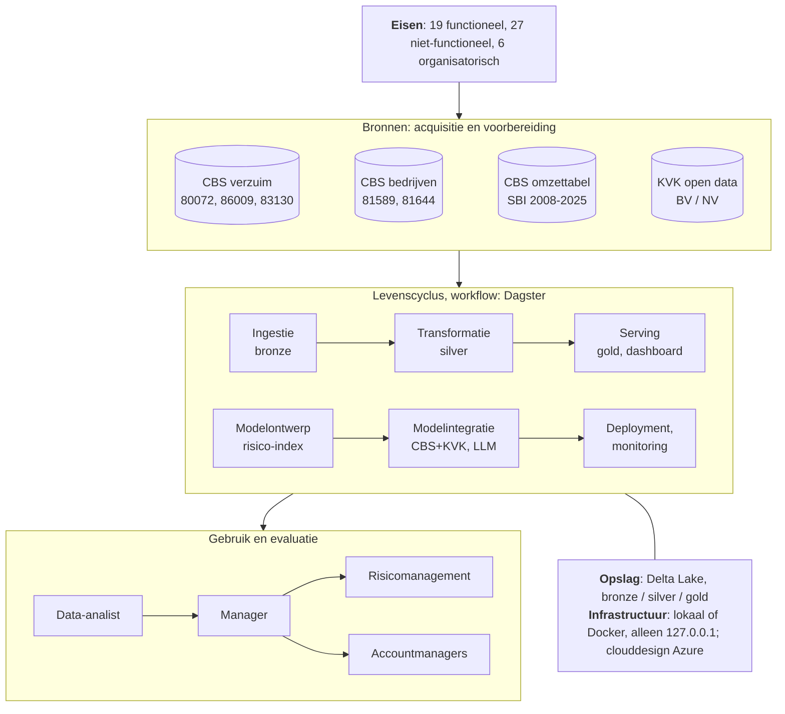

# Verzuimrisico per sector en bedrijfsgrootte

**Een data- en AI-engineeringbenadering voor een inkomensverzekeraar**

| | |
|---|---|
| Vak | Data and AI Engineering, Erasmus Universiteit Rotterdam |
| Docent | prof.dr.ir. M. Janssen |
| Auteur | Stefan *(volledige naam en studentnummer invullen)* |
| Code | <https://github.com/stefancodecommit/AOV_Lakehouse> |
| Datum | *(datum van inleveren)* |

---

## Managementsamenvatting

*Wordt als laatste geschreven, als de rest van het rapport vaststaat.*

---

## 1. Introductie van het vraagstuk

### 1.1 Aanleiding en organisatiebehoefte

De organisatie in dit project is een verzekeraar van inkomensverzekeringen: zij keert uit
wanneer een verzekerde ziek is of niet meer kan werken. Het schaderisico van zo'n
verzekeraar is in de kern een verzuimrisico. Hoe vaak en hoe lang mensen verzuimen,
verschilt sterk per sector en per bedrijfsgrootte. De verzekeraar heeft daarom een
betrouwbaar en actueel beeld nodig van die verschillen: om risico's te beoordelen, de
portefeuille te bewaken en werkgevers te adviseren over preventie.

De verzekeraar heeft eigen benchmarks, gebaseerd op polis- en schadegegevens. Die bevatten
privacygevoelige gegevens, waaronder gezondheidsgegevens van verzekerden, en kunnen in dit
project niet worden gebruikt. De op één na beste bron is openbaar: de verzuimstatistieken
van het CBS. Die vervangen de eigen cijfers niet, maar voegen iets toe wat de eigen cijfers
niet kunnen bieden:

- **geen privacyrisico:** geaggregeerde openbare gegevens die vrij te combineren en zelfs
  met werkgevers te delen zijn;
- **de hele markt:** cijfers voor elke sector en grootteklasse, ook waar de verzekeraar
  weinig polissen heeft en de eigen benchmark dun is;
- **onafhankelijk:** een externe referentie om de eigen cijfers aan te toetsen.

Het probleem is dat die cijfers verspreid staan over meerdere CBS-tabellen met eigen
codes, voorlopige en definitieve versies, en een sectorindeling die in 2025 is vernieuwd
(SBI 2008 naar SBI 2025). Wie ze handmatig combineert, doet dat traag, foutgevoelig en
niet herhaalbaar. Dit project maakt er een herhaalbaar dataproduct van: de openbare cijfers
worden automatisch opgehaald, gecontroleerd, gecombineerd en actueel gehouden, met elk getal
herleidbaar tot de bron.

### 1.2 Doelen

1. **Risico's per SBI-sector en grootteklasse vinden** met een privacyvrije, externe
   benchmark, naast de eigen benchmarks van de verzekeraar.
2. **Vroeg signaleren:** stijgend verzuim in een sector per kwartaal zichtbaar maken,
   voordat het in de schadelast te zien is.
3. **Preventieadvies onderbouwen** met cijfers over de aard van het verzuim (frequentie,
   duur, werkgerelateerdheid, oorzaken), inclusief foutmarges.
4. **Elk risico wegen naar omvang:** hoeveel bedrijven een sector en grootteklasse omvatten,
   ook bedrijven van zelfstandigen.

Daarnaast gelden technische doelen: dezelfde gegevens nooit dubbel opvragen of opslaan,
geen foute gegevens in het eindresultaat, automatisch en alleen werken als er iets nieuws
is, en draaien op elke machine met één commando.

### 1.3 Onderzoeksvragen en aannames

De hoofdvraag is: **welke bedrijfskenmerken (sector en grootteklasse) gaan samen met
hoger ziekteverzuim?** Daaruit volgen zes deelvragen:

1. Welke sectoren hebben het hoogste en laagste verzuim, en hoe ver liggen ze van het
   landelijk gemiddelde?
2. Stijgt of daalt het verzuim met de bedrijfsgrootte?
3. Zijn die verschillen stabiel in de tijd, of stijgen bepaalde sectoren of
   grootteklassen?
4. Waar het verzuim hoog is: wat zit erachter? Meer mensen die verzuimen, langer verzuim,
   of meer werkgerelateerd verzuim?
5. Is een verschil echt, of valt het binnen de foutmarge van de enquête?
6. Hoeveel bedrijven vertegenwoordigt elke sector en grootteklasse, zodat een hoog
   percentage kan worden afgewogen tegen het aantal bedrijven?

Bij deze vragen gelden de volgende **aannames en beperkingen**:

- **Werknemers, geen zelfstandigen.** De verzuimcijfers van het CBS beschrijven
  werknemers. Voor producten voor zelfstandigen zijn ze een benadering, geen meting.
- **Sector of grootte, niet beide.** Het CBS publiceert verzuim per sector *of* per
  grootteklasse, nooit gecombineerd ("kleine bouwbedrijven" bestaat niet in de bron).
- **Samenhang, geen oorzaak.** Een sector met hoog verzuim is een groep met een hoger
  risico; de cijfers zeggen niet waarom, en niets over één bedrijf of persoon.
- **Voorlopige cijfers.** De nieuwste kwartalen zijn voorlopig en kunnen nog wijzigen.
- **Seizoen.** Verzuim piekt in de winter; vergelijkingen gebeuren daarom met hetzelfde
  kwartaal een jaar eerder of met een gemiddelde over vier kwartalen.
- **Openbare gegevens volstaan als benchmark.** Het project neemt aan dat landelijke
  cijfers per sector en grootteklasse een bruikbare referentie zijn naast de eigen
  portefeuille; die aanname moet de verzekeraar zelf toetsen.

## 2. Eisenpakket

De volledige eisen, elk met prioriteit, status en de test die ze aantoont, staan in de
repository ([docs/requirements.md](requirements.md)). Dit hoofdstuk geeft de hoofdlijnen.

### 2.1 Datatoeleveranciers, ontwikkelaars en gebruikers

| Rol | Wie | Behoefte of bijdrage |
|---|---|---|
| Datatoeleverancier | **CBS**: verzuim (80072NED per kwartaal; 86009NED en 83130NED per jaar, met 95%-intervallen), aantallen bedrijven (81589NED, 81644NED) en de omzettabel SBI 2008 naar 2025 | openbaar (CC BY 4.0), opgehaald via de OData-API; geen afspraken over beschikbaarheid |
| Datatoeleverancier | **KVK**: open dataset basisbedrijfsgegevens (alleen BV's en NV's, zonder namen of adressen) | een zip-bestand, door een medewerker gedownload; hergebruik voor het herleiden van bedrijven is niet toegestaan |
| Ontwikkelaar en beheerder | **data engineer** (in dit project ik; bij de verzekeraar het datateam) | bouwt en onderhoudt de pijplijn, laadt maandelijks het KVK-bestand, volgt fouten en waarschuwingen op |
| Directe gebruiker | **data-analist** | vindt de risico's per SBI-sector en grootteklasse en beoordeelt of een verschil echt is |
| Indirecte gebruikers | **manager** van de analist; **risicomanagement**; **accountmanagers** van werkgevers | de manager beslist wat actie verdient; risicomanagement bewaakt de portefeuille; accountmanagers adviseren werkgevers over preventie |
| Betrokken bij gebruik | **functionaris gegevensbescherming** en **informatiebeveiliging** | zekerheid dat geen persoonsgegevens worden verwerkt; zeggenschap voordat interne gegevens worden gekoppeld |

De keten is daarmee: de analist vindt een risico, de manager besluit, en de bevinding gaat
naar risicomanagement of naar de accountmanagers.

### 2.2 Technische en organisatorische eisen

De eisen zijn ingedeeld volgens MoSCoW (*must, should, could*). Er zijn 19 functionele
eisen (wat het systeem moet doen) en 27 niet-functionele eisen (hoe goed). De belangrijkste:

| Soort | Eis (selectie) |
|---|---|
| Functioneel | alleen nieuwe gegevens ophalen; een herziene voorlopige periode vervangt de oude rijen; elke batch controleren vóór het wegschrijven en afgekeurde batches in quarantaine zetten |
| Functioneel | KVK-sectoren vertalen naar SBI 2008; twijfelgevallen markeren in plaats van gokken |
| Functioneel | per sector en grootteklasse een **risico-index** met relatief risico, bandbreedte, oordeel en trend; voorlopige cijfers overal gemarkeerd, met de keuze "alleen definitieve cijfers" |
| Functioneel | elk getal herleidbaar: welke run het maakte, welke invoerversies, uit welke bronkolom |
| Betrouwbaarheid | elke stap is veilig te herhalen; een mislukte run laat de gepubliceerde tabellen ongemoeid; foute gegevens bereiken het dashboard niet |
| Prestatie en schaalbaarheid | draait op één gewone machine; het geheugen groeit niet mee met het aantal bewaarde KVK-momentopnamen |
| Beveiliging en privacy | geen persoonsgegevens; KVK-groepen onder de 10 bedrijven verborgen; geen geheimen in de code; alleen bereikbaar vanaf de eigen machine |
| Onderhoudbaarheid | alle instellingen in één bestand; geautomatiseerde tests bij elke wijziging; dezelfde pakketversies overal |
| Uitlegbaarheid | het risicomodel is een *white box*: elk getal is met de hand na te rekenen en in woorden uitgelegd |

Daarnaast zijn er zes **organisatorische eisen**, waaronder: een analist die de
SBI-indeling en foutmarges kan lezen; *human in command* (mensen nemen de beslissingen
over premies, acceptatie en advies); een eigenaar van het platform die fouten opvolgt en
maandelijks het KVK-bestand laadt; en betrokkenheid van de functionaris
gegevensbescherming vóórdat interne gegevens worden gekoppeld.

**Stand van zaken:** alle *must*-eisen zijn gerealiseerd en aangetoond met tests of
metingen. Open staan twee lagere eisen: meldingen per e-mail of chat bij fouten (*could*)
en een standaardwachtwoord van de database met de rungeschiedenis van Dagster (*should*).
Beide zijn bewust open gelaten voor dit prototype en worden in het clouddesign opgelost.

### 2.3 Randvoorwaarden

De resultaten zijn alleen bruikbaar onder deze voorwaarden:

1. De cijfers beschrijven **werknemers**; voor zelfstandigen zijn ze een benadering.
2. De bandbreedte van de risico-index toont **stabiliteit** over acht kwartalen, geen
   statistische zekerheid; alleen de enquête (86009NED) geeft echte 95%-intervallen.
3. **Groepen, geen individuen:** nooit één werkgever of verzekerde beoordelen op basis van
   een sectorcijfer.
4. **Samenhang, geen oorzaak.**
5. **Alleen openbare gegevens.** Koppelen aan eigen polis- of schadegegevens vraagt eerst
   een DPIA en de instemming van de functionaris gegevensbescherming (gezondheidsgegevens,
   AVG artikel 9).
6. **Prototype-infrastructuur.** Productiegebruik vraagt de cloudomgeving uit het
   clouddesign, echte geheimen en meldingen.

## 3. Conceptuele benadering

### 3.1 Het data- en AI-engineeringcanvas

Figuur 1 vult het canvas uit de colleges in voor dit project: van de eisen en de bronnen
links, via de levenscyclus in het midden, naar het gebruik rechts.

*Figuur 1. Het canvas voor dit project.*

| Canvaselement | Invulling |
|---|---|
| Eisen | de eisen uit hoofdstuk 2, elk met een test of meting als bewijs |
| Bronnen, acquisitie en voorbereiding | vier openbare bronnen; CBS via de API (*pull*, maandelijks), KVK en de omzettabel als bestand |
| Workflow | Dagster: schema's, automatische vervolgstappen na nieuwe gegevens, blokkerende controles tussen de lagen |
| Levenscyclus | alle zes stappen; per stap een README in de repository met een *proof of working* |
| Opslag | Delta Lake in drie lagen (*medallion*): bronze zoals ontvangen, silver opgeschoond, gold klaar voor gebruik |
| Veilige infrastructuur | lokaal of Docker Compose, alleen bereikbaar vanaf de eigen machine; een clouddesign voor Azure |
| Gebruik en evaluatie | de analist werkt met het dashboard; bevindingen lopen via de manager naar risicomanagement en accountmanagers |

### 3.2 Data-acquisitie en -voorbereiding

De gegevens worden **getrokken** (*pull*): het CBS publiceert geen meldingen, dus de
pijplijn vraagt maandelijks per tabel welke perioden er zijn en haalt alleen op wat nog
ontbreekt. Elk verzoek krijgt een sleutel die de periode en de CBS-status (voorlopig of
definitief) bevat. Wordt een voorlopige periode herzien, dan verandert de sleutel en
vervangt de nieuwe versie de oude rijen. Zo wordt niets dubbel opgevraagd of opgeslagen.

Voorbereiding gebeurt in twee stappen. **Bronze** bewaart elk record precies zoals
ontvangen (als tekst én als kolom per veld), met herkomst en tijdstip. Elke batch wordt
vóór het wegschrijven gecontroleerd tegen de metadata van de tabel zelf; een afgekeurde
batch gaat met een rapport in quarantaine en wordt de volgende keer opnieuw geprobeerd.
**Silver** geeft de codes betekenis, zet de typen goed en verwijdert de opvulspaties van
het CBS. Bijzondere gevallen worden **gemarkeerd in plaats van opgelost**: een onbekende
code, een bedrijf met twee hoofdactiviteiten of een code die in beide SBI-versies bestaat,
blijft staan met een vlag die uitlegt wat er bijzonder aan is. Zo maakt de pijplijn geen
aannames die de gebruiker niet kan zien.

### 3.3 Modelontwerp en trainingsaanpak

Het project heeft twee soorten modellen. Het **datamodel** in silver is een
sterschema-achtige opzet van dimensies (periode, sector, grootteklasse, regio,
enquêtemaat) en feiten (verzuim, enquête, aantallen bedrijven). Daarop is het
**kwantitatieve model** gebouwd: de risico-index per sector en grootteklasse
(paragraaf 4.2 beschrijft de berekening).

Voor de risico-index is bewust gekozen voor een *white-box*-model van eenvoudige
rekenregels, en niet voor machine learning:

- **de vraag is beschrijvend:** waar is het risico hoger en stijgt het? Er wordt niets
  voorspeld over individuen;
- **er is weinig data:** 26 kwartalen voor zo'n 38 groepen, te weinig om een model
  betrouwbaar te trainen en te valideren;
- **uitlegbaarheid en verantwoording:** de analist moet elk getal aan een manager kunnen
  uitleggen. Dat sluit aan bij de aanbeveling uit de colleges om voor verantwoording
  regels te gebruiken die mensen kunnen controleren (De Bruijn, Janssen & Warnier, 2022).

Er is daarom geen training in de gebruikelijke zin. Wat er wel is, is **kalibratie en
validatie**: de parameters (een venster van acht kwartalen, een trenddrempel van 0,05 per
jaar) staan in één configuratiebestand, en tests op gegevens met een vooraf bekend
antwoord bewijzen dat de berekening klopt.

### 3.4 Systeemintegratie

Drie integraties maken van losse bronnen één systeem:

1. **CBS en KVK via de omzettabel.** De KVK registreert bedrijven in SBI 2025, het CBS
   publiceert in SBI 2008. Via de omzettabel worden KVK-bedrijven aan CBS-sectoren
   gekoppeld; gevallen die de tabel niet eenduidig kan vertalen, worden gemarkeerd.
2. **Verzuim en aantallen bedrijven.** De risico-index koppelt het verzuim aan het aantal
   bedrijven per sector, waaronder bedrijven van zelfstandigen, zodat een risico kan
   worden gewogen naar omvang.
3. **Een taalmodel in de ingestie.** Een lokaal taalmodel (via Ollama) helpt de
   medewerker het KVK-bestand te vinden en te controleren, maar kan zelf niets laden:
   controle en laden zijn gewone code, en pas na een bevestiging door de medewerker wordt
   er geschreven (*human in the loop*).

De onderdelen zijn **los gekoppeld**: de scripts roepen elkaar niet aan, maar delen alleen
gegevens via de lakehouse. Dagster bepaalt de volgorde en start een laag pas als de laag
eronder haar controles heeft doorstaan.

## 4. Implementatie

### 4.1 Gebruikte methoden en tools

Bij elke keuze is gekeken naar wat past bij de omvang (ongeveer 120 MB, met ongeveer
300 MB groei per jaar) en bij de eisen, niet naar wat het zwaarste is.

| Tool | Waarvoor | Waarom deze, en niet het alternatief |
|---|---|---|
| **Delta Lake** via delta-rs (Python) | opslag van alle lagen | transacties, versies (*time travel*) en een open formaat, zonder Spark of databaseserver; Spark is bedoeld voor clusters en terabytes, hier zou het alleen opstarttijd en geheugen kosten |
| **pandas** (met pyarrow) | transformaties | ruim voldoende bij deze omvang (silver CBS ongeveer 3 seconden). Polars is overwogen voor het deel dat groeit (KVK); het geheugenprobleem bleek met een incrementele opzet beter op te lossen (4.4) |
| **Dagster** | workflow | werkt met *assets* en controles per laag, start een laag alleen na nieuwe gegevens en geslaagde controles, en toont herkomst per kolom; een eenvoudige planner (cron) kan dat niet |
| **Streamlit** met Altair | dashboard | in Python, dus testbaar met dezelfde tests als de pijplijn, en gratis; Power BI is een optie voor later (clouddesign) |
| **Docker Compose** | uitrol | dezelfde omgeving op elke machine met één commando |
| **pytest** en **GitHub Actions** | testen | tests bij elke wijziging, op een schone machine met Python 3.12 |
| **Ollama** met een lokaal taalmodel | KVK-intake | draait op de eigen machine: er gaat niets naar een externe dienst |

De gegevens doorlopen drie lagen (*medallion*-architectuur): **bronze** bewaart wat binnenkwam,
**silver** schoont op en koppelt, **gold** bevat de tabellen voor het dashboard. Elke laag
wordt alleen gebouwd uit de laag eronder, zodat elke stap opnieuw kan worden uitgevoerd
zonder de bron opnieuw te bevragen.

### 4.2 Toepassingen: het dashboard en de risico-index

Het **dashboard** is gebouwd voor de data-analist en heeft zeven pagina's: een overzicht,
de risico-index, sectoren, grootteklassen, "achter de cijfers" (wat verschilt van landelijk
buiten de foutmarge), context (aantallen bedrijven) en een datawoordenboek. Op elke pagina
staan de nieuwste periode, of die voorlopig is, de datum van de gegevens en de bron.

De **risico-index** rekent per sector en grootteklasse:

| Uitkomst | Berekening |
|---|---|
| relatief risico | verzuim van de groep over de laatste vier kwartalen ÷ het landelijk verzuim over dezelfde kwartalen; 1,00 is landelijk |
| bandbreedte | het laagste en hoogste relatieve risico per kwartaal over de laatste acht kwartalen |
| oordeel | bandbreedte geheel boven 1: *hoger*; geheel onder 1: *lager*; anders *rond landelijk* |
| trend | helling van een rechte lijn door de acht kwartaalwaarden, per jaar; boven +0,05 *stijgend*, onder -0,05 *dalend* |
| omvang | aantal bedrijven, waarvan door natuurlijke personen (zelfstandigen) |
| toelichting | één zin die de rij in woorden uitlegt |

Doordat elk kwartaal wordt gedeeld door het landelijk cijfer van datzelfde kwartaal, valt
het seizoenseffect weg en zijn kwartalen direct vergelijkbaar. De index bestaat in twee
varianten: met alle cijfers en met alleen definitieve cijfers.

Voor de **data engineer** zijn er twee hulpmiddelen: een overzicht van alle tabellen met
problemen en waarschuwingen, en een viewer die elke tabel, elke versie en
datakwaliteitsstatistieken toont.

### 4.3 Testen en validatie

Er zijn **373 geautomatiseerde tests**, van vier soorten:

- **eenheidstests** op de logica (codes ontleden, controles, de berekening van de
  risico-index) met kleine, zelfgemaakte gegevens waarvan het juiste antwoord vooraf
  bekend is;
- **integratietests** op echte Delta-tabellen in een tijdelijke map: schrijven,
  herschrijven, een run die halverwege stopt, opnieuw draaien;
- **paginatests:** elke dashboardpagina wordt zonder browser uitgevoerd, met en zonder
  "alleen definitieve cijfers";
- **workflowtests:** Dagster voert de stappen uit met de controles ertussen.

De tests draaien bij elke wijziging in **GitHub Actions** op een schone machine met de
exacte pakketversies, gevolgd door het bouwen van de Docker-image. Dat leverde al een
echte vondst op: een nieuwe installatie kreeg pandas 3, waarmee de code nog niet werkt.
De pakketversies liggen sindsdien vast.

Drie aanvullende manieren van valideren:

1. **Opzettelijk gebroken code:** bij belangrijke tests is de code expres kapotgemaakt om
   te zien of de test dat opmerkt; dat deed hij telkens.
2. **Vergelijken op de echte gegevens:** na grote wijzigingen moesten de resultaten gelijk
   blijven. Na het herstructureren van bronze waren alle elf silvertabellen identiek; na
   de incrementele opzet van KVK ook alle 1.921.911 rijen.
3. **Controles in de pijplijn zelf:** elke CBS-batch wordt vóór het wegschrijven
   gecontroleerd, en elke laag wordt gecontroleerd (unieke sleutels, sleutels die in hun
   dimensie bestaan, één run per laag) voordat de volgende laag wordt gebouwd.

### 4.4 Deployment en monitoring

**Uitrol.** Het project draait lokaal of met Docker Compose (Dagster, het dashboard en een
database voor de rungeschiedenis). De diensten zijn alleen bereikbaar vanaf de eigen
machine, de containers draaien zonder beheerdersrechten, en de pakketversies zijn overal
gelijk. Het clouddesign beschrijft de stap naar Azure.

**Workflow.** Dagster haalt op de eerste van de maand de CBS-gegevens op. Is er niets
nieuws, dan gebeurt er verder niets; anders worden silver en gold opnieuw gebouwd, maar
alleen als de controles van de laag eronder zijn geslaagd. Het KVK-bestand wordt door een
medewerker geladen. Er schrijft nooit meer dan één run tegelijk. Op de vijftiende van de
maand ruimt onderhoud op: quarantaine na 90 dagen, KVK-momentopnamen (de nieuwste plus één
per maand) en oude bestandsversies na zeven dagen.

**Monitoring.** Mislukte runs en controles zijn zichtbaar in Dagster; versheidscontroles
waarschuwen als een bron te oud is of door het CBS is gestopt. Elke silver- en goldrun
staat in een runlog met tijdstip, codeversie, invoerversies en uitkomst.

**Prestaties en schaalbaarheid.** Silver CBS duurt ongeveer 3 seconden, gold ongeveer 17,
silver KVK ongeveer 10. Het onderdeel dat groeit is KVK: elke bewaarde momentopname telt
1,9 miljoen rijen. De eerste opzet bouwde alles elke keer opnieuw en had steeds meer
geheugen nodig. De huidige opzet voegt alleen nieuwe momentopnamen toe en verwerkt ze één
voor één. Gemeten met vier gesimuleerde momentopnamen: 1,65 GB voor een volledige
herbouw (eerst 3,2 GB) en 0,18 GB als er niets nieuws is.

### 4.5 Data provenance en uitlegbaarheid

**Herkomst.** Voor elk van de 282 kolommen in silver en gold is vastgelegd uit welke
kolommen in de laag eronder ze komen en wat ermee gebeurt. Een test faalt zodra een nieuwe
kolom geen herkomst heeft. De herkomst is te volgen in een interactieve verkenner (van een
goldkolom terug naar de bronvelden, of andersom), in gegenereerde documentatie en in
Dagster. Daarnaast draagt elke rij in silver en gold het nummer van de run die haar
maakte, bewaart bronze elk record precies zoals ontvangen, en krijgt elke afgekeurde batch
een rapport.

**Uitlegbaarheid.** De risico-index is met de hand na te rekenen en geeft per rij een
toelichting in woorden. Bijzondere gevallen zijn zichtbaar gemarkeerd, voorlopige cijfers
zijn overal herkenbaar, en de enquêtecijfers tonen hun 95%-interval. Zo kan de analist bij
elk getal zeggen waar het vandaan komt en hoe zeker het is, en precies dat is nodig om een
bevinding met vertrouwen aan de manager door te geven.

## 5. Evaluatie

### 5.1 Resultaten en hun betekenis

**Sectoren.** Over de laatste vier kwartalen (tot en met het tweede kwartaal van 2026) ligt
het verzuim in 5 van de 19 SBI-secties duidelijk boven landelijk (5,5%), in alle acht
kwartalen. De gezondheids- en welzijnszorg springt eruit met een relatief risico van 1,40
(7,7%), gevolgd door water en afval (1,24), openbaar bestuur (1,17), vervoer en opslag
(1,15) en industrie (1,15). Het laagst zijn horeca (0,61), landbouw (0,61) en
specialistische zakelijke dienstverlening (0,64). Alleen "overige dienstverlening" stijgt
(+0,06 per jaar), al ligt die sectie nog onder landelijk: precies het soort vroeg signaal
waarvoor de index bedoeld is.

**Wat erachter zit.** De jaarenquête van 2025 laat voor de zorg zien waaróm het risico hoger
is, en dat is relevant voor een inkomensverzekeraar: meer werknemers verzuimen (54,3% tegen
50,7%), het verzuim duurt langer (19,4 tegen 17,3 dagen; langdurig verzuim van 20 tot 210
dagen 14,3% tegen 11,4%) en is vaker werkgerelateerd (27,5% tegen 22,5%), met als
opvallendste redenen besmetting op het werk (28,7% tegen 14,0%) en emotioneel zwaar werk.
Tegelijk liggen 42 van de 65 enquêtematen voor de zorg binnen de foutmarge: niet elk
verschil is echt.

**Bedrijfsgrootte.** Het verzuim stijgt met de grootte: kleine bedrijven (1 tot 10
werkzame personen) zitten op 0,48 van landelijk, grote (100 of meer) op 1,16. De enquête
bevestigt het patroon: het aandeel werknemers dat verzuimt, loopt op van 33,8% bij 1 tot 5
werknemers tot ongeveer 53% vanaf 50 werknemers, en vlakt af vanaf zo'n 20 werknemers.

**Kritische kanttekeningen.** De cijfers zijn betrouwbaar als beschrijving, maar beperkt als
verklaring:

- **Samenstelling, geen oorzaak.** Sectoren verschillen in leeftijd, geslacht en soort
  werk van hun werknemers. Het hogere risico van de zorg kan voor een deel daaruit
  voortkomen; de gegevens kunnen dat niet scheiden.
- **Het grootte-effect is niet eenduidig.** Kleine bedrijven verzuimen minder, maar of dat
  komt door het werk, door doorwerken bij ziekte of door hoe verzuim wordt geregistreerd,
  blijkt niet uit de cijfers.
- **Stabiliteit is geen zekerheid.** De bandbreedte van de index laat zien hoe stabiel een
  sector is, geen statistische foutmarge.
- **Het trendsignaal is gevoelig voor voorlopige cijfers.** Met alleen definitieve cijfers
  (tot en met het vierde kwartaal van 2025) blijven de niveaus en de rangorde gelijk:
  dezelfde vijf secties boven landelijk, dezelfde hoogste en laagste. Maar dan stijgt niet
  "overige dienstverlening" maar "delfstoffenwinning". Een stijgende trend moet de analist
  dus altijd ook met definitieve cijfers bekijken voordat hij die doorgeeft.
- **Datakwaliteit KVK.** Bij 90% van de actieve bedrijven is de sector eenduidig te bepalen;
  de rest is gemarkeerd. Het KVK-bestand bevat 381.513 identieke rijen. Omdat het bestand
  geen KVK-nummer bevat, is niet vast te stellen of dat dubbele regels zijn of verschillende
  bedrijven met dezelfde kenmerken; ze zijn daarom bewaard en niet verwijderd.

Voor de verzekeraar betekent dit: de index wijst betrouwbaar aan *waar* het risico hoger
ligt en of het verandert, en de enquête geeft aanknopingspunten voor preventie. *Waarom*
een sector hoger ligt en wat dat voor één werkgever betekent, vraagt het eigen oordeel van
analist en accountmanager.

### 5.2 Verwachte voordelen en risico's

**Voordelen.** Een privacyvrije, onafhankelijke benchmark van de hele markt naast de eigen
cijfers; een kwartaalsignaal vóórdat stijgend verzuim in de schadelast zichtbaar wordt;
onderbouwing voor preventiegesprekken met werkgevers; en cijfers die automatisch actueel
blijven en tot de bron herleidbaar zijn, waar dat eerder handwerk was.

**Risico's.** Het risicoregister (in de repository: R1 tot en met R18) laat zien dat de
grootste risico's niet in de gegevens zitten, maar in het **gebruik** ervan:

- een sectorcijfer gebruiken om één werkgever te beoordelen (*ecological fallacy*);
- werknemerscijfers zonder meer toepassen op producten voor zelfstandigen;
- premiedifferentiatie naar sector die indirect een beschermde groep benadeelt (de zorg
  heeft bijvoorbeeld vooral vrouwelijke werknemers). Dat moet compliance beoordelen
  voordat de index invloed krijgt op premies.

Technisch zijn de belangrijkste open punten een back-up van de KVK-historie (een oude
momentopname is niet opnieuw te downloaden) en het automatisch scannen van de gebruikte
pakketten op kwetsbaarheden.

### 5.3 Onderhoud, privacy en beveiliging

**Onderhoud.** Het systeem werkt maandelijks automatisch; het enige terugkerende handwerk is
het KVK-bestand laden. Onderhoud is vastgelegd in een README per fase, een
instructiebestand en de tests. Het grootste onderhoudsrisico is afhankelijkheid van één
beheerder; een overdracht aan het datateam van de verzekeraar ligt voor de hand.

**Privacy.** Er worden geen persoonsgegevens van verzekerden of burgers verwerkt; alleen de
KVK-uploadlog legt vast welke medewerker een bestand bevestigde. Wel kan een bedrijf op
rijniveau herleidbaar zijn (851.804 van de 1,9 miljoen bedrijven zijn uniek op regio,
SBI-code en startdatum); het dashboard toont daarom alleen aantallen, met groepen onder de
10 verborgen. Een DPIA is pas nodig als deze cijfers aan eigen schadegegevens worden
gekoppeld.

**Beveiliging.** Alles is alleen bereikbaar vanaf de eigen machine, er zijn geen geheimen
nodig en containers draaien zonder beheerdersrechten. Het clouddesign voegt inloggen via
Entra ID, rollen, Key Vault en afgeschermde netwerkverbindingen toe.

### 5.4 Gebruik van generatieve AI

Het project is gebouwd met Claude (Anthropic) als ontwikkelassistent: eerst voor een
projectopzet, daarna, via Claude Code in VS Code, voor code, tests, documentatie en
analyses. Dat is in de repository transparant vastgelegd: alle commits, op de
plaatshouder van GitHub na, vermelden Claude als co-auteur, en een apart document beschrijft de werkwijze
([docs/genai_use.md](genai_use.md)).

**Werkwijze.** Ik bepaalde de richting en nam de beslissingen; de assistent onderzocht,
stelde opties voor, bouwde de gekozen oplossing en testte die. Belangrijke keuzes kwamen van
mij, zoals bijzondere gevallen markeren in plaats van aannames doen, een gestructureerde
bronzelaag, de vraag of de oplossing schaalt, en de keuze voor een verzekeraar als
organisatie.

**Voordelen:** veel meer omvang en grondigheid (tests, metingen, documentatie) dan anders
haalbaar was, en uitleg op de eigen code. **Nadelen en risico's:** generatieve AI kan met
stelligheid iets beweren wat niet klopt. Dat gebeurde ook: zo werden testen in GitHub
Actions als gedaan afgevinkt terwijl ze nog nooit hadden gedraaid, en werd een functie in
Dagster beschreven die in de gratis versie niet bestaat. Beide zijn ontdekt en
gecorrigeerd, onder meer door de vraag "hoe heb je dat getest?". Daarom is niets op
vertrouwen aangenomen: tests, metingen op de echte gegevens en controles tegen de bron.
Gegevens van de verzekeraar zijn nooit met de assistent gedeeld.

*Eigen reflectie (door de auteur te schrijven): wat generatieve AI betekende voor het leren
en het resultaat, en wat ik een volgende keer anders zou doen.*
