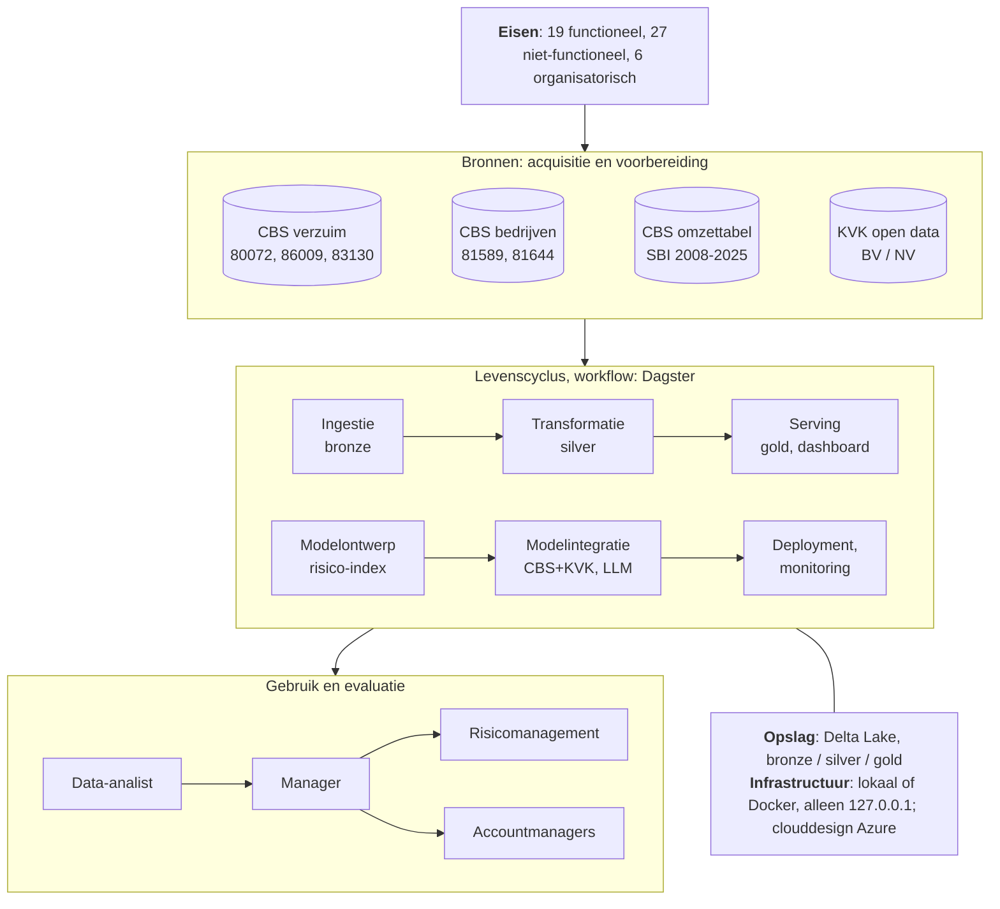

# Verzuimrisico per sector en bedrijfsgrootte

**Een data- en AI-engineeringbenadering voor een inkomensverzekeraar**

| | |
|---|---|
| Vak | Data and AI Engineering, Erasmus Universiteit Rotterdam |
| Docent | prof.dr.ir. M. Janssen |
| Auteur | Stefan *(volledige naam en studentnummer invullen)* |
| Code | <https://github.com/stefancodecommit/AOV_Lakehouse> |
| Datum | *(datum van inleveren)* |

---

## Managementsamenvatting

*Wordt als laatste geschreven, als de rest van het rapport vaststaat.*

---

## 1. Introductie van het vraagstuk

### 1.1 Aanleiding en organisatiebehoefte

De organisatie in dit project is een verzekeraar van inkomensverzekeringen: zij keert uit
wanneer een verzekerde ziek is of niet meer kan werken. Het schaderisico van zo'n
verzekeraar is in de kern een verzuimrisico. Hoe vaak en hoe lang mensen verzuimen,
verschilt sterk per sector en per bedrijfsgrootte. De verzekeraar heeft daarom een
betrouwbaar en actueel beeld nodig van die verschillen: om risico's te beoordelen, de
portefeuille te bewaken en werkgevers te adviseren over preventie.

De verzekeraar heeft eigen benchmarks, gebaseerd op polis- en schadegegevens. Die bevatten
privacygevoelige gegevens, waaronder gezondheidsgegevens van verzekerden, en kunnen in dit
project niet worden gebruikt. De op één na beste bron is openbaar: de verzuimstatistieken
van het CBS. Die vervangen de eigen cijfers niet, maar voegen iets toe wat de eigen cijfers
niet kunnen bieden:

- **geen privacyrisico:** geaggregeerde openbare gegevens die vrij te combineren en zelfs
  met werkgevers te delen zijn;
- **de hele markt:** cijfers voor elke sector en grootteklasse, ook waar de verzekeraar
  weinig polissen heeft en de eigen benchmark dun is;
- **onafhankelijk:** een externe referentie om de eigen cijfers aan te toetsen.

Het probleem is dat die cijfers verspreid staan over meerdere CBS-tabellen met eigen
codes, voorlopige en definitieve versies, en een sectorindeling die in 2025 is vernieuwd
(SBI 2008 naar SBI 2025). Wie ze handmatig combineert, doet dat traag, foutgevoelig en
niet herhaalbaar. Dit project maakt er een herhaalbaar dataproduct van: de openbare cijfers
worden automatisch opgehaald, gecontroleerd, gecombineerd en actueel gehouden, met elk getal
herleidbaar tot de bron.

### 1.2 Doelen

1. **Risico's per SBI-sector en grootteklasse vinden** met een privacyvrije, externe
   benchmark, naast de eigen benchmarks van de verzekeraar.
2. **Vroeg signaleren:** stijgend verzuim in een sector per kwartaal zichtbaar maken,
   voordat het in de schadelast te zien is.
3. **Preventieadvies onderbouwen** met cijfers over de aard van het verzuim (frequentie,
   duur, werkgerelateerdheid, oorzaken), inclusief foutmarges.
4. **Elk risico wegen naar omvang:** hoeveel bedrijven een sector en grootteklasse omvatten,
   ook bedrijven van zelfstandigen.

Daarnaast gelden technische doelen: dezelfde gegevens nooit dubbel opvragen of opslaan,
geen foute gegevens in het eindresultaat, automatisch en alleen werken als er iets nieuws
is, en draaien op elke machine met één commando.

### 1.3 Onderzoeksvragen en aannames

De hoofdvraag is: **welke bedrijfskenmerken (sector en grootteklasse) gaan samen met
hoger ziekteverzuim?** Daaruit volgen zes deelvragen:

1. Welke sectoren hebben het hoogste en laagste verzuim, en hoe ver liggen ze van het
   landelijk gemiddelde?
2. Stijgt of daalt het verzuim met de bedrijfsgrootte?
3. Zijn die verschillen stabiel in de tijd, of stijgen bepaalde sectoren of
   grootteklassen?
4. Waar het verzuim hoog is: wat zit erachter? Meer mensen die verzuimen, langer verzuim,
   of meer werkgerelateerd verzuim?
5. Is een verschil echt, of valt het binnen de foutmarge van de enquête?
6. Hoeveel bedrijven vertegenwoordigt elke sector en grootteklasse, zodat een hoog
   percentage kan worden afgewogen tegen het aantal bedrijven?

Bij deze vragen gelden de volgende **aannames en beperkingen**:

- **Werknemers, geen zelfstandigen.** De verzuimcijfers van het CBS beschrijven
  werknemers. Voor producten voor zelfstandigen zijn ze een benadering, geen meting.
- **Sector of grootte, niet beide.** Het CBS publiceert verzuim per sector *of* per
  grootteklasse, nooit gecombineerd ("kleine bouwbedrijven" bestaat niet in de bron).
- **Samenhang, geen oorzaak.** Een sector met hoog verzuim is een groep met een hoger
  risico; de cijfers zeggen niet waarom, en niets over één bedrijf of persoon.
- **Voorlopige cijfers.** De nieuwste kwartalen zijn voorlopig en kunnen nog wijzigen.
- **Seizoen.** Verzuim piekt in de winter; vergelijkingen gebeuren daarom met hetzelfde
  kwartaal een jaar eerder of met een gemiddelde over vier kwartalen.
- **Openbare gegevens volstaan als benchmark.** Het project neemt aan dat landelijke
  cijfers per sector en grootteklasse een bruikbare referentie zijn naast de eigen
  portefeuille; die aanname moet de verzekeraar zelf toetsen.

## 2. Eisenpakket

De volledige eisen, elk met prioriteit, status en de test die ze aantoont, staan in de
repository ([docs/requirements.md](requirements.md)). Dit hoofdstuk geeft de hoofdlijnen.

### 2.1 Datatoeleveranciers, ontwikkelaars en gebruikers

| Rol | Wie | Behoefte of bijdrage |
|---|---|---|
| Datatoeleverancier | **CBS**: verzuim (80072NED per kwartaal; 86009NED en 83130NED per jaar, met 95%-intervallen), aantallen bedrijven (81589NED, 81644NED) en de omzettabel SBI 2008 naar 2025 | openbaar (CC BY 4.0), opgehaald via de OData-API; geen afspraken over beschikbaarheid |
| Datatoeleverancier | **KVK**: open dataset basisbedrijfsgegevens (alleen BV's en NV's, zonder namen of adressen) | een zip-bestand, door een medewerker gedownload; hergebruik voor het herleiden van bedrijven is niet toegestaan |
| Ontwikkelaar en beheerder | **data engineer** (in dit project ik; bij de verzekeraar het datateam) | bouwt en onderhoudt de pijplijn, laadt maandelijks het KVK-bestand, volgt fouten en waarschuwingen op |
| Directe gebruiker | **data-analist** | vindt de risico's per SBI-sector en grootteklasse en beoordeelt of een verschil echt is |
| Indirecte gebruikers | **manager** van de analist; **risicomanagement**; **accountmanagers** van werkgevers | de manager beslist wat actie verdient; risicomanagement bewaakt de portefeuille; accountmanagers adviseren werkgevers over preventie |
| Betrokken bij gebruik | **functionaris gegevensbescherming** en **informatiebeveiliging** | zekerheid dat geen persoonsgegevens worden verwerkt; zeggenschap voordat interne gegevens worden gekoppeld |

De keten is daarmee: de analist vindt een risico, de manager besluit, en de bevinding gaat
naar risicomanagement of naar de accountmanagers.

### 2.2 Technische en organisatorische eisen

De eisen zijn ingedeeld volgens MoSCoW (*must, should, could*). Er zijn 19 functionele
eisen (wat het systeem moet doen) en 27 niet-functionele eisen (hoe goed). De belangrijkste:

| Soort | Eis (selectie) |
|---|---|
| Functioneel | alleen nieuwe gegevens ophalen; een herziene voorlopige periode vervangt de oude rijen; elke batch controleren vóór het wegschrijven en afgekeurde batches in quarantaine zetten |
| Functioneel | KVK-sectoren vertalen naar SBI 2008; twijfelgevallen markeren in plaats van gokken |
| Functioneel | per sector en grootteklasse een **risico-index** met relatief risico, bandbreedte, oordeel en trend; voorlopige cijfers overal gemarkeerd, met de keuze "alleen definitieve cijfers" |
| Functioneel | elk getal herleidbaar: welke run het maakte, welke invoerversies, uit welke bronkolom |
| Betrouwbaarheid | elke stap is veilig te herhalen; een mislukte run laat de gepubliceerde tabellen ongemoeid; foute gegevens bereiken het dashboard niet |
| Prestatie en schaalbaarheid | draait op één gewone machine; het geheugen groeit niet mee met het aantal bewaarde KVK-momentopnamen |
| Beveiliging en privacy | geen persoonsgegevens; KVK-groepen onder de 10 bedrijven verborgen; geen geheimen in de code; alleen bereikbaar vanaf de eigen machine |
| Onderhoudbaarheid | alle instellingen in één bestand; geautomatiseerde tests bij elke wijziging; dezelfde pakketversies overal |
| Uitlegbaarheid | het risicomodel is een *white box*: elk getal is met de hand na te rekenen en in woorden uitgelegd |

Daarnaast zijn er zes **organisatorische eisen**, waaronder: een analist die de
SBI-indeling en foutmarges kan lezen; *human in command* (mensen nemen de beslissingen
over premies, acceptatie en advies); een eigenaar van het platform die fouten opvolgt en
maandelijks het KVK-bestand laadt; en betrokkenheid van de functionaris
gegevensbescherming vóórdat interne gegevens worden gekoppeld.

**Stand van zaken:** alle *must*-eisen zijn gerealiseerd en aangetoond met tests of
metingen. Open staan twee lagere eisen: meldingen per e-mail of chat bij fouten (*could*)
en een standaardwachtwoord van de database met de rungeschiedenis van Dagster (*should*).
Beide zijn bewust open gelaten voor dit prototype en worden in het clouddesign opgelost.

### 2.3 Randvoorwaarden

De resultaten zijn alleen bruikbaar onder deze voorwaarden:

1. De cijfers beschrijven **werknemers**; voor zelfstandigen zijn ze een benadering.
2. De bandbreedte van de risico-index toont **stabiliteit** over acht kwartalen, geen
   statistische zekerheid; alleen de enquête (86009NED) geeft echte 95%-intervallen.
3. **Groepen, geen individuen:** nooit één werkgever of verzekerde beoordelen op basis van
   een sectorcijfer.
4. **Samenhang, geen oorzaak.**
5. **Alleen openbare gegevens.** Koppelen aan eigen polis- of schadegegevens vraagt eerst
   een DPIA en de instemming van de functionaris gegevensbescherming (gezondheidsgegevens,
   AVG artikel 9).
6. **Prototype-infrastructuur.** Productiegebruik vraagt de cloudomgeving uit het
   clouddesign, echte geheimen en meldingen.

## 3. Conceptuele benadering

### 3.1 Het data- en AI-engineeringcanvas

Figuur 1 vult het canvas uit de colleges in voor dit project: van de eisen en de bronnen
links, via de levenscyclus in het midden, naar het gebruik rechts.

*Figuur 1. Het canvas voor dit project.*

| Canvaselement | Invulling |
|---|---|
| Eisen | de eisen uit hoofdstuk 2, elk met een test of meting als bewijs |
| Bronnen, acquisitie en voorbereiding | vier openbare bronnen; CBS via de API (*pull*, maandelijks), KVK en de omzettabel als bestand |
| Workflow | Dagster: schema's, automatische vervolgstappen na nieuwe gegevens, blokkerende controles tussen de lagen |
| Levenscyclus | alle zes stappen; per stap een README in de repository met een *proof of working* |
| Opslag | Delta Lake in drie lagen (*medallion*): bronze zoals ontvangen, silver opgeschoond, gold klaar voor gebruik |
| Veilige infrastructuur | lokaal of Docker Compose, alleen bereikbaar vanaf de eigen machine; een clouddesign voor Azure |
| Gebruik en evaluatie | de analist werkt met het dashboard; bevindingen lopen via de manager naar risicomanagement en accountmanagers |

### 3.2 Data-acquisitie en -voorbereiding

De gegevens worden **getrokken** (*pull*): het CBS publiceert geen meldingen, dus de
pijplijn vraagt maandelijks per tabel welke perioden er zijn en haalt alleen op wat nog
ontbreekt. Elk verzoek krijgt een sleutel die de periode en de CBS-status (voorlopig of
definitief) bevat. Wordt een voorlopige periode herzien, dan verandert de sleutel en
vervangt de nieuwe versie de oude rijen. Zo wordt niets dubbel opgevraagd of opgeslagen.

Voorbereiding gebeurt in twee stappen. **Bronze** bewaart elk record precies zoals
ontvangen (als tekst én als kolom per veld), met herkomst en tijdstip. Elke batch wordt
vóór het wegschrijven gecontroleerd tegen de metadata van de tabel zelf; een afgekeurde
batch gaat met een rapport in quarantaine en wordt de volgende keer opnieuw geprobeerd.
**Silver** geeft de codes betekenis, zet de typen goed en verwijdert de opvulspaties van
het CBS. Bijzondere gevallen worden **gemarkeerd in plaats van opgelost**: een onbekende
code, een bedrijf met twee hoofdactiviteiten of een code die in beide SBI-versies bestaat,
blijft staan met een vlag die uitlegt wat er bijzonder aan is. Zo maakt de pijplijn geen
aannames die de gebruiker niet kan zien.

### 3.3 Modelontwerp en trainingsaanpak

Het project heeft twee soorten modellen. Het **datamodel** in silver is een
sterschema-achtige opzet van dimensies (periode, sector, grootteklasse, regio,
enquêtemaat) en feiten (verzuim, enquête, aantallen bedrijven). Daarop is het
**kwantitatieve model** gebouwd: de risico-index per sector en grootteklasse
(paragraaf 4.2 beschrijft de berekening).

Voor de risico-index is bewust gekozen voor een *white-box*-model van eenvoudige
rekenregels, en niet voor machine learning:

- **de vraag is beschrijvend:** waar is het risico hoger en stijgt het? Er wordt niets
  voorspeld over individuen;
- **er is weinig data:** 26 kwartalen voor zo'n 38 groepen, te weinig om een model
  betrouwbaar te trainen en te valideren;
- **uitlegbaarheid en verantwoording:** de analist moet elk getal aan een manager kunnen
  uitleggen. Dat sluit aan bij de aanbeveling uit de colleges om voor verantwoording
  regels te gebruiken die mensen kunnen controleren (De Bruijn, Janssen & Warnier, 2022).

Er is daarom geen training in de gebruikelijke zin. Wat er wel is, is **kalibratie en
validatie**: de parameters (een venster van acht kwartalen, een trenddrempel van 0,05 per
jaar) staan in één configuratiebestand, en tests op gegevens met een vooraf bekend
antwoord bewijzen dat de berekening klopt.

### 3.4 Systeemintegratie

Drie integraties maken van losse bronnen één systeem:

1. **CBS en KVK via de omzettabel.** De KVK registreert bedrijven in SBI 2025, het CBS
   publiceert in SBI 2008. Via de omzettabel worden KVK-bedrijven aan CBS-sectoren
   gekoppeld; gevallen die de tabel niet eenduidig kan vertalen, worden gemarkeerd.
2. **Verzuim en aantallen bedrijven.** De risico-index koppelt het verzuim aan het aantal
   bedrijven per sector, waaronder bedrijven van zelfstandigen, zodat een risico kan
   worden gewogen naar omvang.
3. **Een taalmodel in de ingestie.** Een lokaal taalmodel (via Ollama) helpt de
   medewerker het KVK-bestand te vinden en te controleren, maar kan zelf niets laden:
   controle en laden zijn gewone code, en pas na een bevestiging door de medewerker wordt
   er geschreven (*human in the loop*).

De onderdelen zijn **los gekoppeld**: de scripts roepen elkaar niet aan, maar delen alleen
gegevens via de lakehouse. Dagster bepaalt de volgorde en start een laag pas als de laag
eronder haar controles heeft doorstaan.
